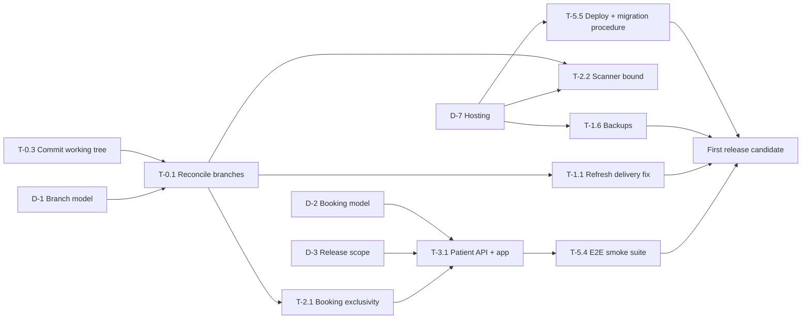

# Medora — Dependency and Blocker Register

Audit date 2026-11-09. Task IDs (`T-x.y`) and decision IDs (`D-n`) are defined in
`REMEDIATION_ROADMAP.md`; finding IDs in `FULL_TECHNICAL_AUDIT.md`.

## 1. Critical path

The longest chain is **T-0.3 → T-0.1 → T-2.1 → T-3.1 → T-5.4 → release**. T-3.1 (30–50
engineer-days) dominates it and cannot start until two decisions (D-2, D-3) are made.
Decisions are therefore on the critical path from day one, although they cost no
engineering time.

## 2. Blocked by a decision (product, security, clinical, legal)

| Decision | Needed from | Tasks blocked | Findings waiting | Cost of delay |
| --- | --- | --- | --- | --- |
| D-1 Branch model going forward | Engineering lead | T-0.1 (how to reconcile, and what to do afterwards) | MED-ARCH-001 | Every other backend and mobile task is done on a diverging base |
| D-2 Patient booking model (ADR-033, *proposed*) | Product and clinical | T-3.1 step 1 | MED-MOB-001 | The patient app's central workflow stays unbuilt |
| D-3 First-release scope: roles, patient messaging, AI | Product owner | T-2.4, T-2.5, T-3.1 steps 2–4, T-3.4, all of Phase 4 | MED-BE-004, MED-BE-005, MED-AI-001 | Work is done on features that may be cut, or not done on ones that are needed |
| D-4 Session and password policy; revocation latency | Security owner | T-1.5, T-1.9 | MED-SEC-004, MED-SEC-007, MED-SEC-008 | *[withheld: security-sensitive]* |
| D-5 Retention, export and erasure policy | Legal / compliance | T-1.7 (export and retention half) | MED-SEC-006 | No answer to a data-subject request |
| D-6 Single-clinic first, or multi-hospital before release | Product and architecture | T-3.2 route shapes, web AI seam, anything touching tenancy | MED-ARCH-003, MED-FE-001 | The largest re-architecture stays unscheduled while features wait on it |
| D-7 Hosting for API, database, object store, scanner | Engineering lead | T-1.3, T-1.6, T-1.7 (evidence half), T-2.2, T-5.5 | MED-OPS-001, MED-OPS-002, MED-SEC-003, MED-SEC-005, MED-BE-001 | No backup, no deployable backend |
| D-8 Third-party processors: AI, push, SMS, error tracking, crash reporting | Legal and engineering | T-3.4, T-4.1, T-5.6, T-3.5 (crash vendor) | MED-BE-003, MED-AI-003, MED-OPS-003 | Each is a processor of patient data and cannot be chosen by engineering alone |
| Clinical owner named | Organisation | T-4.2, T-4.4, emergency content in T-3.1 | MED-AI-002, MED-MOB-001 | No AI output and no emergency number may be shown to a user |
| Communication content-access grant duration | Product owner | Enabling admin content access (`COMMUNICATION_GRANT_TTL_MINUTES` has no default, `env.schema.ts:177`) | part of MED-FE-001 | The endpoint fails closed until set |

## 3. Blocked by backend work

| Blocked task or feature | Waiting on | Notes |
| --- | --- | --- |
| Patient booking, cancellation, rescheduling in the app | T-3.1 step 1 (routes do not exist), T-2.1 | The app already carries the flow and an idempotency key |
| Patient health records in the app | T-3.1 step 2 | Needs a result-release policy |
| Patient messaging | T-3.1 step 4 | Conversations admit staff roles only |
| Clinic information and emergency contacts in the app | T-3.1 step 3 | |
| Document and attachment download, web and mobile | T-2.2 | Fixed on `origin/backend`; needs T-0.1 |
| Push notifications on the device | T-3.4 | Port unbound |
| Pharmacy dispensing, reception workflows | T-2.5 | No capability or route |
| Web AI assistant on real output | T-4.1, T-4.2, T-4.3 | Gateway unbound |
| Admin backup panel | T-1.6 | `501` today |
| Admin platform-status panel | T-5.6 | Needs monitoring probes |

## 4. Blocked by database work or migrations

| Task | Migration | Risk and ordering |
| --- | --- | --- |
| T-2.1 Booking exclusivity | Exclusion constraint, `btree_gist` | Pre-flight for existing overlaps; migrate before deploying the code that maps the violation |
| T-1.5 Session and password policy | `password_changed_at`, `absolute_expires_at` | Additive; backfill needed for existing rows |
| T-2.6 AI message lifecycle | New enum value `PENDING` | Enum additions in PostgreSQL are not transactional with their first use; ship in two steps |
| T-2.7 Index review | New indexes | Use `CREATE INDEX CONCURRENTLY` on a populated database |
| T-3.1 Patient API | Slots, possibly patient conversation participants | Depends on D-2 |
| MED-ARCH-003 Multi-hospital | Tenant key across 111 models | A programme, not a task; depends on D-6 |

All migration work depends on T-0.1: `backend` already holds two schema files changed
relative to `HEAD` (`backend/prisma/schema`, per the branch comparison), and a migration
written against the wrong base will collide.

## 5. Blocked by frontend or mobile work

| Blocked outcome | Waiting on |
| --- | --- |
| Administrators reading the audit ledger in a live build | T-3.2 (adapter) — the server route exists |
| Clinic management, overview, communications oversight in a live build | T-3.2 |
| Staff messaging threads | T-3.3 |
| Server-driven idle lock | Web half of T-1.5 |
| Push delivery end to end | App half of T-3.4 (no push library installed) |
| Store submission | T-3.5 |

## 6. Blocked by AI or external-service work

| Blocked outcome | Waiting on |
| --- | --- |
| Any model output shown to a clinician | D-8 → T-4.1 → T-4.2 → T-4.3 |
| Any model output shown to a patient | T-4.4, a separate programme with clinical validation |
| Malware-scanned downloads | A clamd service (T-2.2) |
| SMS and push | Providers (D-8) |
| Production email | An SMTP provider with credentials (`productionRules` requires `SMTP_USER`) |
| Calendar integrations | An OAuth client per provider (`settings.service.ts:234-239`) |

## 7. Blocked by unavailable environments or test data

| Blocked activity | Missing | Effect in this audit |
| --- | --- | --- |
| Running the backend e2e suite locally | PostgreSQL 16 and Redis 7 (Docker daemon not running on the audit machine) | 104 e2e specs not executed |
| Reproducing MED-SEC-001 and MED-DB-001 | A running API with a database | Both remain "confirmed (static)" |
| Live validation of web integration | A database for the API | The project's own record notes the same gap |
| Performance baseline | The k6 suite and dataset exist only on `origin/backend` | No numbers |
| Verifying migrations apply | A scratch database; `db:check` needs a shadow database | Not run |
| Device-level mobile testing | A device or simulator and an EAS project | Not run |
| Branch-protection and required-check settings | GitHub repository administration access | Not observable |

A standing, disposable integration environment (the compose stack plus seed) would
remove the first five rows. It is implied by T-5.4.

## 8. Work that can proceed independently, now

None of these needs a decision, another task or a running environment beyond CI.

| Task | Finding | Effort |
| --- | --- | --- |
| T-0.2 README and demo labelling | MED-DOC-001, MED-FE-002 | 0.5–1 d |
| T-0.3 Commit the working tree in slices | MED-REL-001 | 0.5 d |
| T-1.1 Refresh delivery fix (apply to `main` and `backend` if T-0.1 is not done) | MED-SEC-001 | 0.5–1 d |
| T-1.2 Fail closed on environment | MED-SEC-002 | 0.5 d |
| T-1.4 Dependency gate and *[withheld: security-sensitive]* upgrade | MED-CI-002 | 1–2 d |
| T-1.8 Web transport and CSP | MED-SEC-009, MED-SEC-010 | 1.5–2.5 d |
| T-2.3 Readiness probe | MED-BE-002 | 1 d |
| T-5.1 CI gate | MED-CI-001 | < 0.5 d |
| T-5.2 Pin the runtime | MED-CI-003 | 0.5–1 d |
| T-5.3 Portable backend specs | MED-TEST-002, MED-TEST-003 | 0.5–1 d |

## 9. Parallelisable work

Once T-0.1 is done, four streams can run side by side with little file overlap:

| Stream | Tasks | Main directories |
| --- | --- | --- |
| A — Backend security and integrity | T-1.1, T-1.2, T-1.3, T-1.5, T-2.1, T-2.3, T-2.6 | `backend/src/modules/auth`, `config`, `modules/appointments`, `modules/health` |
| B — Web | T-1.8, T-3.2, T-3.3, T-6.4 | `frontend/src` |
| C — Infrastructure and release | T-1.6, T-2.2, T-5.5, T-5.6 | new infrastructure definitions, `backend/Dockerfile` |
| D — Quality | T-1.4, T-5.1, T-5.2, T-5.3, T-5.4 | `.github/workflows`, test trees |

Contention points to manage: `.github/workflows/ci.yml` (streams C and D),
`backend/src/config/env.schema.ts` (streams A and C), and the permission catalogue,
whose frontend copy is the source of truth for a backend parity spec
(`ci.yml:105-118`) — a change there touches streams A and B together.

## 10. Dependency cycles

| Cycle | Description | How to break it |
| --- | --- | --- |
| Tenancy ↔ integration | Web sections and the web AI seam are held until the multi-hospital model exists (`features/doctor/ai/service.ts:9-15`), while the multi-hospital plan assumes integrated single-clinic features to migrate | Decide D-6. If single-clinic ships first, integrate now against today's routes and accept rework. |
| Booking model ↔ booking integrity | Patient booking (T-3.1) needs the exclusivity guarantee (T-2.1); the shape of that guarantee depends on whether slots are published entities (D-2) | Ship the range-exclusion constraint now. It is correct under either model. |
| Parity tests ↔ branch divergence | Cross-tree parity specs keep contracts aligned but only run when both trees are at one commit; divergence makes them pass against stale counterparts, which hides the drift that would motivate reconciling | T-0.1, then keep trees together. |
| Backup panel ↔ backup pipeline | The in-product panel waits for an artifact pipeline; the pipeline was deferred to milestones the panel's comments say do not exist yet, though they now do | Treat infrastructure-level backup (T-1.6) as primary and the panel as optional. |

## 11. Ownership gaps

Observed from the repository; not a judgement on any individual.

| Gap | Evidence | Consequence |
| --- | --- | --- |
| No named clinical owner | Referred to as absent in `patient-app/src/features/ai/availability.ts` and in emergency content rules | AI and emergency work cannot be signed off |
| No infrastructure or SRE ownership | No infrastructure code, runbook or on-call document | Backups, deployment, monitoring unowned (MED-OPS-001 to -003) |
| No security or compliance owner | Policy values without enforcement; open retention question | D-4 and D-5 have nobody to make them |
| Promotion to `main` | 255- and 431-commit divergence | Nobody owns keeping the trunk whole |
| Concentrated authorship | `git shortlog -sn HEAD`: 680 of 1,179 commits carry an automated-agent author; most of the rest sit under a handful of similarly named identities whose mapping to people this audit did not establish; two other authors have one commit each | Review independence and continuity should be confirmed by the team |
| The `Ai` integration branch | Holds documentation only | A domain branch with no code and no owner of code |
