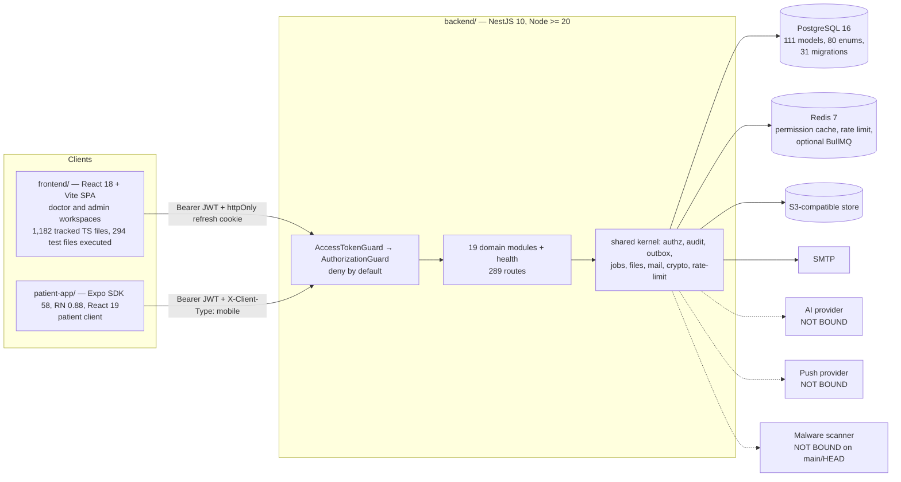

# Medora — Full Technical Audit

| | |
| --- | --- |
| Audit date | 2026-11-09 |
| Audited tree | Branch `claude/emr-visual-redesign` at `ad4c6a8d` (identical to `origin/frontend`), **plus the uncommitted working tree**: 92 modified files, 1 deleted, 13 untracked |
| Other refs read | `origin/main` (`58b229e9`), `origin/backend` (`0c95b7d3`), `origin/patient-app` (`2ecc9071`), `origin/Ai`, `origin/Database` — read-only, to establish where they differ |
| Engagement | Audit only. No source, test, configuration, schema or Git state was changed. |

**How to read this report.** Findings carry stable IDs used across all nine reports.
Security findings (`MED-SEC-*`, `MED-CI-002`) are detailed in
`SECURITY_AND_PRIVACY_AUDIT.md` and only summarised here. Confidence has three values:

- **Confirmed (executed)** — observed in a command run during this audit.
- **Confirmed (static)** — established by reading the cited lines; not reproduced against
  a running system, because no database, Redis or object store was available.
- **Probable / Unverified** — stated with the evidence that is missing.

Effort estimates are engineer-days for one engineer familiar with the codebase, before
investigation. They are ranges, they exclude review and release time, and they assume
the fix lands on a single reconciled trunk (see MED-ARCH-001). Treat them as sizing, not
commitments.

---

## 1. Finding register

| ID | Sev | Confidence | Subsystem | Title | Blocks release |
| --- | --- | --- | --- | --- | --- |
| MED-SEC-001 | P1 | Confirmed (static) | Backend auth | *[withheld: security-sensitive]* | Yes |
| MED-DB-001 | P1 | Confirmed (static) | Appointments / DB | Double booking is possible under concurrency | Yes |
| MED-ARCH-001 | P1 | Confirmed (executed) | Repository | No branch contains the whole product; integration branches have diverged by hundreds of commits | Yes |
| MED-BE-001 | P1 | Confirmed (static) | Files | Every scan-gated file download is permanently refused on `main` and `HEAD` | Yes |
| MED-OPS-001 | P1 | Confirmed (static) | Operations | No backup or restore capability exists | Yes |
| MED-AI-001 | P1 | Confirmed (static) | AI | No AI model is integrated anywhere; all AI features are absent, mocked or disabled | Yes, for any AI claim |
| MED-MOB-001 | P1 | Confirmed (static) | Patient app | Core patient workflows have no backend and are unavailable in a production build | Yes |
| MED-SEC-002 | P2 | Confirmed (static) | Backend config | *[withheld: security-sensitive]* | Yes |
| MED-SEC-003 | P2 | Confirmed (static) | Backend | *[withheld: security-sensitive]* | Yes |
| MED-SEC-004 | P2 | Confirmed (static) | Backend / web | *[withheld: security-sensitive]* | Yes |
| MED-SEC-005 | P2 | Unverified | Infrastructure | Encryption of PHI at rest and in transit not evidenced | Yes |
| MED-SEC-006 | P2 | Confirmed (static) | Privacy | No data export or erasure path | Decision needed |
| MED-CI-002 | P2 | Confirmed (executed) | Supply chain | Known-vulnerable dependencies; no security scanning in CI | Yes |
| MED-AI-002 | P2 | Confirmed (static, latent) | AI | No output-safety layer on the generation path | Yes, before a provider |
| MED-AI-003 | P2 | Confirmed (static, latent) | AI / privacy | Patient identity sent to a third-party provider with no recorded decision | Yes, before a provider |
| MED-ARCH-002 | P2 | Confirmed (static) | Cross-layer | Clients and API are built against different route sets | Yes |
| MED-ARCH-003 | P2 | Confirmed (static) | Data model | Single-clinic schema versus a planned multi-hospital product | Decision needed |
| MED-BE-002 | P2 | Confirmed (static) | Backend ops | Readiness probe checks only the database | No |
| MED-BE-003 | P2 | Confirmed (static) | Notifications | Push and SMS delivery are not implemented | Depends on scope |
| MED-BE-004 | P2 | Confirmed (static) | Authorization model | Reception, laboratory, pharmacy and nurse roles have incomplete or empty workflows | Depends on scope |
| MED-BE-005 | P2 | Confirmed (static) | Backend | Seven advertised operations answer `501 not_implemented` | Depends on scope |
| MED-FE-001 | P2 | Confirmed (static) | Web | Most of the administrator area is demo-only in a live build | Depends on scope |
| MED-MOB-002 | P2 | Confirmed (static) | Patient app / CI | Node runtime requirement for Expo SDK 58 differs between branches and CI | Yes |
| MED-CI-001 | P2 | Confirmed (static) | CI | *[withheld: security-sensitive]* | Yes |
| MED-TEST-001 | P2 | Confirmed (static) | Testing | No end-to-end test crosses a client and the real API | Yes |
| MED-OPS-002 | P2 | Confirmed (static) | Release | No backend deployment or migration-release definition | Yes |
| MED-OPS-003 | P2 | Confirmed (static) | Observability | No error tracking, alerting or operational runbooks | Yes |
| MED-DOC-001 | P2 | Confirmed (static) | Documentation | Root README is materially stale and promises unimplemented features | No |
| MED-SEC-007 | P3 | Confirmed (static) | Backend auth | *[withheld: security-sensitive]* | No |
| MED-SEC-008 | P3 | Confirmed (static) | Backend auth | *[withheld: security-sensitive]* | No |
| MED-SEC-009 | P3 | Confirmed (static) | Web | *[withheld: security-sensitive]* | No |
| MED-SEC-010 | P3 | Confirmed (static) | Web hosting | *[withheld: security-sensitive]* | No |
| MED-DB-002 | P3 | Probable | Schema | 75 of 187 foreign-key columns have no leading index | No |
| MED-AI-004 | P3 | Confirmed (static, latent) | AI | No per-user quota or rate limit on generation | Before a provider |
| MED-AI-005 | P3 | Confirmed (static) | AI | Assistant message is stored as `COMPLETE` before generation begins | No |
| MED-BE-006 | P3 | Confirmed (static) | Jobs | Default job driver fires every schedule on every replica | No |
| MED-TEST-002 | P3 | Confirmed (executed) | Backend tests | AI containment spec fails on Windows and is partly vacuous there | No |
| MED-TEST-003 | P3 | Confirmed (executed) | Backend tests | Three specs in the unit glob need a live Redis | No |
| MED-TEST-004 | P3 | Confirmed (executed) | Web / mobile tests | Suites are timing-sensitive; one web test fails on Node 24 | No |
| MED-CI-003 | P3 | Confirmed (executed) | Tooling | No Node version is pinned; three different majors are in play | No |
| MED-FE-002 | P3 | Confirmed (static) | Web hosting | The only defined web deployment is a mock-data demo | No |
| MED-MOB-003 | P3 | Confirmed (static) | Patient app | Store-release prerequisites are placeholders | Yes, for a store build |
| MED-REL-001 | P3 | Confirmed (executed) | Working tree | Large uncommitted, cross-domain change set on one task branch | No |
| MED-DOC-002 | P3 | Confirmed (static) | Documentation | Documentation sprawl, duplicated ADR systems, stale branch table | No |
| MED-ARCH-004 | P4 | Confirmed (static) | Contracts | API contracts are hand-transcribed across three trees | No |
| MED-CI-004 | P4 | Confirmed (static) | CI | Actions pinned by tag; production source maps emitted | No |
| MED-MOB-004 | P4 | Confirmed (static) | Patient app | `CALL_PHONE` permission with no number configured; no certificate pinning | No |
| MED-FE-003 | P4 | Confirmed (executed) | Web | 20 accepted lint warnings; router future-flag warnings | No |
| MED-DB-003 | P4 | Unverified (project-documented) | `Database` branch | `database/schema.sql` does not load | No |

**Count by severity (each finding counted once):** P0 — 0 · P1 — 7 · P2 — 21 · P3 — 16 · P4 — 5 · total 49.

No P0 is recorded. Nothing found exposes patient data to an unauthenticated caller, and
the repository defines no production deployment that handles real patient data. The P1
findings are what stands between the current state and such a deployment.

---

## 2. Architecture

### 2.1 Observed architecture

Established from manifests, module registries and route tables — not from documentation.

| Fact | Evidence |
| --- | --- |
| Three independent npm packages, no workspace | `backend/package.json`, `frontend/package.json`, `patient-app/package.json`; no root manifest |
| API prefix `/api/v1`, 19 domain modules | `backend/src/main.ts:22`, `backend/src/modules/index.ts:36-56` |
| Both clients select mock or HTTP adapters through one seam | `frontend/src/api/seam.ts`, `patient-app/src/api/seam.ts` |
| Ports with unbound adapters | `shared/ai/ai.module.ts:18`, `shared/push/push.module.ts:13`, `shared/files/file-storage.module.ts:41` |
| No tenant key in the data model | grep of `backend/prisma/schema/*.prisma` for hospital/clinic/tenant columns: none |
| No Python, no ML code, no model weights, no prompt-evaluation data | repository inventory |

### 2.2 Inferred architecture

The following are stated in documentation and were **not** verifiable from code or
configuration: an nginx reverse proxy in front of the API (`backend/docker-compose.yml`
header, "M35 adds the prod-like profile"); a production object store and SMTP provider;
a multi-hospital tenancy model (`docs/multi-hospital/*`, `docs/work-phases/PHASE-20` to
`PHASE-31`). None of these exists in the audited tree.

### 2.3 Architectural strengths

The backend is unusually disciplined for its stage. Authorization is deny-by-default and
structurally separated from authentication. Care scope has a single owner. External
dependencies sit behind ports whose unbound adapters fail loudly instead of returning
plausible fakes. Module boundaries are enforced by lint and by a module-graph test. Both
clients refuse to render fixture data in a production build. These choices are why most
findings below are about *missing* capability and integration, not about unsafe code.

### MED-ARCH-001 — No branch contains the whole product (P1)

| Field | Detail |
| --- | --- |
| Confidence | Confirmed (executed): `git rev-list --left-right --count` on 2026-11-09 |
| Subsystem | Repository topology, release engineering |

**Evidence.** Measured against `origin/main` (`58b229e9`):

| Branch | Behind `main` | Ahead of `main` | What the "ahead" commits hold |
| --- | ---: | ---: | --- |
| `frontend` | 1 | 4 | Expo SDK 58 upgrade, theme playground work |
| `backend` | **255** | **19** | 177 files, +18,768 lines: recovery-code hashing and redemption, envelope-key rotation, ClamAV scanner, idempotency, response compression, cache policy, k6 load suite, nightly perf workflow |
| `patient-app` | **431** | **17** | 2FA recovery sign-in, OTP expiry handling, notification preferences, Node 22 requirement |
| `Ai` | 423 | 18 | Documentation only |
| `Database` | 735 | 5 | A standalone `database/schema.sql` |

The same package is at three versions depending on the branch: `patient-app` declares
`expo ~58.0.23` on `HEAD`/`frontend`/`patient-app`, `~57.0.30` on `main`, and `~52.0.0`
on `backend`. `CLAUDE.md` states that on 2026-09-03 every integration branch was caught
up to `main`; that table is now stale by hundreds of commits (MED-DOC-002).

**Description.** The branch model sends each domain's work to its own integration
branch and promotes to `main` later. Promotion has not kept pace. Security-relevant
backend work (hashing of recovery codes, the malware scanner that unblocks downloads,
key rotation) exists only on `backend`. Patient-app authentication work exists only on
`patient-app`. `main` — the branch `ci.yml:20` calls "what deploys" — has neither.

**Expected vs actual.** Expected: one ref from which the whole product can be built,
tested and released. Actual: the newest backend, the newest patient app and the newest
web client have never been built or tested together.

**Root cause.** Long-lived per-domain integration branches with no scheduled
reconciliation, plus cross-tree parity tests that only run when the *other* tree's
sources are present at the same commit.

**Impact.** Any release is a release of an untested combination. Fixes land on one
branch and are silently absent from another (MED-BE-001 is fixed on `backend` and broken
on `main`). Every finding in this report must be fixed on, or carried to, more than one
ref. Merge cost grows with every commit.

**Remediation.** Reconcile once: merge `main` into `backend` and `patient-app`, resolve,
then promote both to `main`. After that, either shorten the integration branches' life
(promote on every merged task) or adopt trunk-based development with path-filtered CI,
which `ci.yml` already implements. **Decision required** on which.

**Dependencies.** None; this is the prerequisite for nearly everything else.
**Regression tests.** The full CI matrix on the reconciled trunk, including the backend
e2e suite. **Effort.** 3–6 engineer-days for the reconciliation; high uncertainty,
driven by 255- and 431-commit merges. **Verify.** All five integration branches report
`behind 0`; one commit passes all three suites.

### MED-ARCH-002 — Clients and API are built against different route sets (P2)

**Evidence.**

- Backend routes with **no live web consumer**: `/administration/*` (clinic management,
  queue, waiting room — 40+ routes), `/audit-events`, `/admin/conversations*`,
  `/conversations*`, `/ai/*`. The web sections that would use them are routed to
  `NotConnectedSection` in a live build: `frontend/src/features/admin/routes.tsx:31`
  (`LIVE_SECTIONS = new Set(['appointments'])`), `:39-52` (`demoOnly`).
  `frontend/src/features/doctor/messaging/http/http-messaging-service.ts` connects only
  the unread badge; `frontend/src/features/doctor/ai/service.ts:25` binds the mock
  unconditionally.
- Client needs with **no backend route**: patient booking, cancellation and
  rescheduling; patient health records; patient messaging; clinic profile and
  announcements; emergency contacts; recent activity; any patient AI endpoint
  (`patient-app/src/features/*/service.ts`, each naming its blocking dependency).
- `docs/FE-10-INTEGRATION-STATUS.md` records that live browser validation "could not be
  re-run" for lack of a database.

**Impact.** Completed backend work delivers no user value, and completed client screens
cannot function. **Root cause.** MED-ARCH-001, plus the web integration being gated on
the multi-hospital redesign (MED-ARCH-003). **Remediation.** After reconciliation, drive
integration from `FEATURE_TRACEABILITY_MATRIX.md` one feature at a time, each closed by
an end-to-end test. **Effort.** See the roadmap, Phase 3; 20–40 engineer-days in total.

### MED-ARCH-003 — Single-clinic schema versus a planned multi-hospital product (P2)

**Evidence.** None of the 111 models carries a hospital, clinic or tenant key.
`docs/multi-hospital/` holds 22 planning documents and `docs/work-phases/PHASE-20` to
`PHASE-31` describe a twelve-phase re-architecture. `docs/DECISIONS.md` ADR-031 and
ADR-033 are *proposed*, not accepted. The web AI seam and several web sections are
explicitly held until that work lands (`features/doctor/ai/service.ts:9-15`).

**Impact.** Adding tenancy to 111 tables, every repository query, the permission model
and three clients is the largest single piece of outstanding work, and it invalidates
today's isolation tests. Features are being deferred against a plan that has not started.
**Decision required:** release single-clinic first, or commit to multi-hospital before
any release. **Effort.** Not estimable from this audit; the project's own plan spans
twelve phases.

### MED-ARCH-004 — API contracts are hand-transcribed across three trees (P4)

Types, status vocabularies and the password policy are copied by hand between
`backend`, `frontend` and `patient-app`, and kept honest by parity tests that read the
other tree's source (`.github/workflows/ci.yml:105-132`,
`patient-app/src/test/parity.test.ts`). It works and is well guarded. It is recorded
because it breaks silently whenever the trees are at different commits (MED-ARCH-001),
and a generated contract (OpenAPI or shared Zod schemas) would remove the class of
problem. No action required before release.

---

## 3. Web frontend

**Inspected.** Package manifest, Vite/Vitest/ESLint configuration, `src/api/*`,
`src/configs/*`, `src/app/router/*`, `src/app/providers/AuthProvider.tsx`, every
`service.ts` selection point, `features/admin/routes.tsx`, `vercel.json`, and
repository-wide pattern scans. The 508 files under `features/doctor` and 195 under
`features/admin` were **sampled**, not read line by line.

**Executed.** Typecheck (exit 0), lint (exit 0; 0 errors, 20 warnings), full test suite,
production build (exit 0). See `TESTING_AND_QUALITY_REPORT.md`.

**Observed quality signals (scan of non-test `src/`).**

| Signal | Result |
| --- | --- |
| `dangerouslySetInnerHTML`, `innerHTML`, `eval`, `new Function` | 0 |
| `any` (annotation or cast) | 6 |
| `@ts-ignore` / `@ts-expect-error` / `@ts-nocheck` | 0 |
| `eslint-disable` comments | 7 |
| Locales | 5 (`ar`, `en`, `fa`, `fr`, `tr`); RTL covered by `src/i18n/logical-properties.test.ts` |
| Code splitting | Per-route lazy chunks; entry chunk 318 kB (95 kB gzip), React vendor 202 kB (66 kB gzip) |
| Access token | Memory only (`src/api/client.ts:60`) |
| Route guards | `RequireAuth`, `RequireRole`, `RequirePermission` (`src/app/router/guards.tsx`) — UI convenience; the server enforces |

**Design constraints.** The two standing rules were checked against the working tree by
search, not by rendering. No violation was identified, and none is recommended here:
no decorative coloured card edges, and no hover labels on the collapsed sidebar. The
uncommitted change set touches `Sidebar.tsx`, `AppSidebar.tsx` and several card
components; a visual review of that work against both rules should be part of its own
pull request, since this audit did not run the application.

### MED-FE-001 — Most of the administrator area is demo-only in a live build (P2)

**Evidence.** `frontend/src/features/admin/routes.tsx:31` — `LIVE_SECTIONS` contains only
`appointments`. `:39-52` — every other `section()` resolves to `NotConnectedSection`
when mocks are off. Doctors, access (users/roles) and platform settings are wired
separately (`features/admin/doctors/api/service.ts`, `features/admin/access/service.ts`).
The demo-only set includes the overview, 13 clinic-management sections, patients,
communications oversight, system logs and reports. The stores behind them persist to
`localStorage` (`features/admin/logs/api/logs.api.ts`,
`features/shared-domain/clinic-operations/store.ts`).

**Expected vs actual.** The backend serves `/administration/*`, `/audit-events` and
`/admin/conversations` (route table lines 29-53, 62-63). The web client does not call
them. **Impact.** An administrator on a live build cannot view the audit ledger, manage
the clinic or oversee communications, although the server can answer all three. The
audit ledger being unreadable is also a governance gap. **Root cause.** MED-ARCH-001 and
MED-ARCH-003. **Remediation.** Write HTTP adapters section by section, audit log first.
**Regression tests.** Adapter contract tests in the existing pattern, plus the
end-to-end tests of MED-TEST-001. **Effort.** 10–20 engineer-days. **Verify.** A live
build shows server data in each section and `LIVE_SECTIONS` covers them.

### MED-FE-002 — The only defined web deployment is a mock-data demo (P3)

`frontend/vercel.json` builds with `npm run build:demo`, `VITE_APP_ENV=staging` and
`VITE_ENABLE_MOCKS=true`, and deploys only from `main`. The root `README.md` publishes
the seeded demo credentials. This is a legitimate demo and reaches no API. It is
recorded because there is no configuration for a *live* web deployment, and because the
demo is indistinguishable by URL from a real product. Ensure the demo is unmistakably
labelled and that a live deployment gets its own project and configuration.

### MED-FE-003 — Accepted warnings (P4)

Lint reports 20 `react-refresh/only-export-components` warnings, matching the ceiling
documented in `CLAUDE.md`. Tests emit React Router v7 future-flag warnings. Neither
blocks anything.

Related findings: MED-SEC-009, MED-SEC-010 (security report), MED-AI-001 (web assistant
is a canned-reply generator), MED-TEST-004.

---

## 4. Patient mobile application

**Inspected.** `package.json`, `app.json`, `eas.json`, `src/configs/env.ts`,
`src/api/seam.ts`, `src/api/client.ts`, all seven `src/api/endpoints/*`, every
`features/*/service.ts`, `src/storage/*`, `features/ai/availability.ts`,
`features/emergency/*`, `features/appointments/http-appointment-service.ts`. Screens and
components were sampled.

**Current versions (verified from `patient-app/package.json` at `HEAD`).** Expo
`~58.0.23`, React Native `0.88.1`, React `19.3.0`, TypeScript strict. Compatibility of
that set with upstream release notes was **not** verified externally; the project's own
`src/test/sdk-versions.test.ts` passed.

**Executed.** Typecheck (exit 0), lint (exit 0), Jest suite. `expo export` was not run.

**Feature backing in a production build** (`EXPO_PUBLIC_ENABLE_MOCKS=false`, enforced by
`src/configs/env.ts`):

| Feature | Production adapter | Evidence |
| --- | --- | --- |
| Sign-in, registration, 2FA, sessions | Live HTTP | `src/api/endpoints/auth.ts`, `sessions.ts`, `account.ts` |
| Profile | Live HTTP | `src/api/endpoints/profile.ts` |
| Doctor discovery | Live HTTP (one method unavailable) | `features/doctors/http-doctor-service.ts` |
| Appointments — list and detail | Live HTTP | `src/api/endpoints/appointments.ts:124-146` |
| Appointments — book, cancel, reschedule, slots | **Refuses** (`ADR-033`) | `features/appointments/http-appointment-service.ts:113, 146-150` |
| Notifications and preferences | Live HTTP | `src/api/endpoints/notifications.ts` |
| Health records | **Refuses** (`BE-09 / AD-5`) | `features/health/service.ts:17` |
| Messages | **Refuses** (`AD-1 / BE-13`) | `features/messages/service.ts:152` |
| Clinic profile, hours, announcements | **Refuses** (`BE-11`) | `features/clinic/service.ts:100` |
| Recent activity | **Refuses** (`BE-10`) | `features/home/service.ts:67` |
| Emergency | Static guidance; **no number configured** | `features/emergency/service.ts:24-31` |
| AI assistant, symptom intake, image analysis | **Hard-disabled constant** | `features/ai/availability.ts` (`connected: false`) |

### MED-MOB-001 — Core patient workflows are unavailable in a production build (P1)

| Field | Detail |
| --- | --- |
| Confidence | Confirmed (static) |
| Subsystem | Patient app and backend patient surface |

**Description.** A patient who installs a production build can sign in, edit their
profile, browse doctors, read existing appointments and read notifications. They cannot
book, cancel or reschedule an appointment, read any health record, message anyone, see
clinic information or use any AI feature. The Emergency screen shows guidance text and
cannot dial, because no emergency number is configured and no endpoint supplies one.

**Expected vs actual.** The stated product areas are appointment booking, doctor
discovery, emergency access, AI assistance, messaging and health records. One of six
(doctor discovery) is functional end to end.

**Root cause.** The backend exposes only `GET /me/appointments` and
`GET /me/appointments/:id` for patients
(`backend/src/modules/appointments/controllers/patient-appointment.controller.ts:43-56`);
the same is true on `origin/backend`. The booking model is an open decision (ADR-033,
*proposed*). No patient-facing records, messaging or clinic route exists.

**What the app does well.** It refuses loudly. Every missing capability rejects with a
named dependency (`src/api/seam.ts`, `EndpointNotImplementedError`) and the screens
render an explicit "not available yet" state. No fixture can reach a production build.
That is the correct behaviour and should be preserved.

**Impact.** The patient app is not releasable as a product. **Patient-safety note.** An
Emergency screen that cannot place a call is acceptable only because it says so and
directs the patient to their local emergency number; it must never be marketed as
emergency access. **Remediation.** Decide ADR-033, then build the patient API surface:
booking with the concurrency fix of MED-DB-001, records, messaging, clinic and emergency
configuration. **Dependencies.** MED-ARCH-001, MED-DB-001, ADR-033, a clinical owner for
emergency content. **Regression tests.** Backend e2e per route with a cross-patient
isolation case; app adapter contract tests; a device-level end-to-end test per workflow.
**Effort.** 30–50 engineer-days across backend and app. High uncertainty.
**Verify.** Each row of the table above reads "Live HTTP" and has an end-to-end test.

### MED-MOB-002 — Node requirement for Expo SDK 58 differs between branches and CI (P2)

**Evidence.** `HEAD:patient-app/package.json` declares `"node": ">=20"` with
`expo ~58.0.23`. `origin/patient-app` declares `"node": ">=22.13.0"` (commit `a94d6b39`,
"require Node 22 for Expo SDK 58") and changes the CI job to Node 22.
`HEAD:.github/workflows/ci.yml:288` still installs Node 20 for the patient-app job. The
audit machine runs Node 24.18.0.

**Impact.** On `frontend` and any branch cut from it, the patient-app suite runs on a
runtime the project has since declared unsupported, so a green result there is not
evidence. **Remediation.** Carry `a94d6b39` to every branch that carries SDK 58 — a
by-product of MED-ARCH-001. **Effort.** 0.5 day.

### MED-MOB-003 — Store-release prerequisites are placeholders (P3)

`patient-app/app.json` sets `extra.eas.projectId` to the all-zero UUID. The app version
is `0.1.0`. No store URL, support address, terms URL or privacy-policy URL is configured
(`src/configs/env.ts` treats all four as optional and renders their absence). No push
library is installed (`expo-notifications` is not a dependency), and no crash-reporting
vendor is bound (`src/utils/monitoring.ts` is a redaction port only). All of this is
honestly represented in the UI; it is the checklist for a first store submission.

### MED-MOB-004 — Minor hardening observations (P4)

`app.json` requests `android.permission.CALL_PHONE` while no number can be dialled,
which may draw a store-review question. No certificate pinning is implemented; that is a
reasonable omission at this stage and a decision to record. Root or jailbreak detection
is absent. A `PhiPrivacyShield` component exists for app-switcher privacy.

---

## 5. Backend and API

**Inspected.** `main.ts`, `app.module.ts`, all of `config/` and `common/`, the full
`auth` module's controllers and core services, the entire `shared/authz` kernel, the
`ai`, `files`, `appointments` (services, repository, controllers), `patients` (both
services' scope enforcement), `search`, `platform-settings` and `health` modules, the
`shared/ai`, `shared/files`, `shared/rate-limit` and `shared/jobs` kernels, and the
generated 289-route authorization table. The `labs`, `pharmacy`, `medical-records`,
`messaging`, `notifications`, `reports`, `doctors`, `users`, `dashboard`,
`administration` and `audit` modules were **inspected by route table, targeted search
and sampling only**. They total roughly 35,000 lines and were not read in full.

**Executed.** Typecheck (exit 0), lint (exit 0), the `src/**/*.spec.ts` subset. The
e2e suite (104 files under `backend/test/`) was **not** run: it needs PostgreSQL and
Redis.

### MED-BE-001 — Every scan-gated download is permanently refused on `main` and `HEAD` (P1)

| Field | Detail |
| --- | --- |
| Confidence | Confirmed (static) |
| Present on | `HEAD`, `origin/main`. **Fixed on `origin/backend`**, which binds a ClamAV adapter when `CLAMAV_HOST` is set and requires it in production. |

**Evidence.** `backend/src/shared/files/file-storage.module.ts:41` binds
`MALWARE_SCANNER` to `UnconfiguredMalwareScanner`, whose `scan()` always returns
`'unavailable'` (`unconfigured-malware-scanner.ts`). `shared/files/scan-gate.ts`
(`assertScanClean`) allows a download only when `scan_result === 'clean'`.
`modules/files/services/files.service.ts` calls the gate in `downloadUrl`; the same gate
guards message, record and lab attachment downloads.

**Description.** Uploads succeed and rows are written. No file ever becomes `clean`, so
every download of a patient document, record attachment, lab report or message
attachment answers `403 scan_pending` forever. The gate fails closed, which is the safe
direction: this is a functional defect, not a disclosure.

**Impact.** Document and attachment workflows are non-functional on the branch that
deploys. **Root cause.** The fix was merged to `backend` and never promoted
(MED-ARCH-001). **Remediation.** Promote the `backend` branch's scanner adapter and add
a clamd service to the deployment. **Dependencies.** MED-ARCH-001, MED-OPS-002.
**Regression tests.** `malware-scan.e2e-spec.ts` exists on `backend`; add an
upload-scan-download round trip. **Effort.** 1–2 engineer-days beyond the
reconciliation. **Verify.** Upload a file on a deployed stack and download it.

### MED-BE-002 — Readiness probe checks only the database (P2)

`backend/src/modules/health/health.module.ts:29` registers a single indicator
(`DatabaseHealthIndicator`). Redis, the object store and SMTP are hard requirements at
boot (`env.schema.ts:88-98, 137`), but `/ready` reports them as `unconfigured`. The
container `HEALTHCHECK` (`backend/Dockerfile:45-46`) depends on `/ready`. An instance
with Redis or storage down is therefore kept in rotation. `origin/backend` generalises
the factory to accept more indicators. Remediation: add Redis and storage indicators.
Effort: 1 day.

### MED-BE-003 — Push and SMS delivery are not implemented (P2)

`backend/src/shared/push/push.module.ts:13` binds `UnconfiguredPushProvider`.
`SMS_PROVIDER` defaults to `'stub'` (`env.schema.ts:145`) and
`modules/notifications/services/notification-delivery.service.ts:200` treats SMS and
desktop as stubs. The patient app registers devices (`POST /me/devices`) but has no push
library. Delivered channels are in-app and email only. Appointment reminders and
critical-result alerts therefore reach a user only inside an open application or by
email. Remediation: choose providers (a procurement and privacy decision), bind
adapters. Effort: 5–8 engineer-days after the decision.

### MED-BE-004 — Non-doctor staff roles have incomplete or empty workflows (P2)

**Evidence.** `backend/src/shared/authz/permission-catalogue.ts:235-275`: `pharmacy`
holds only `patients.view` and `messages.send`; `nurse` has no bundle at all
(`:294-311`, deliberately fail-closed). Every prescription route requires
`prescriptions.create`, a doctor-only capability (route table lines 26, 103-104,
135-137, 276-282), so there is no dispensing workflow. `POST /patients` is admitted for
five roles at the guard but refuses anyone without a `doctors` row
(`patient.service.ts:314-321`), so reception cannot register a patient. In the
uncommitted working tree, reception may *read* the queue and waiting room
(`authz-route-matrix.snapshot.txt:47, 52`) but every action on them is admin-only
(`:184-186, 191-192`).

*[Withheld from the published copy: security-sensitive content.]*

**Impact.** Four of seven roles can sign in and do little or nothing. **Decision
required** on which roles are in scope for a first release. **Remediation.** Define
capabilities for the in-scope workflows; introduce a write capability for chart
mutation. **Effort.** 5–15 engineer-days depending on scope.

### MED-BE-005 — Seven advertised operations answer `501 not_implemented` (P2)

| Route | Evidence |
| --- | --- |
| `POST /me/data-export` | `modules/settings/controllers/settings.controller.ts:80-87` |
| `POST /platform-settings/backups` | `modules/platform-settings/services/backup.service.ts:57-64` |
| `POST /platform-settings/backups/:id/restore` | `backup.service.ts:67-74` |
| `GET /administration/platform-status` | `modules/administration/controllers/administration.controller.ts:398-405` |
| `POST /me/integrations/:id/connect` | `modules/settings/services/settings.service.ts:234-239` |
| `POST /reports/export` for `excel` and `pdf` | `modules/reports/services/report-export.service.ts:62-69` |
| Parts of `GET /reports/analytics` | `modules/reports/services/analytics.service.ts:178-184` |

Each refusal is explicit and explains what is missing, which is the right behaviour.
Several comments cite prerequisites ("needs M25 and M30") that have since been built, so
some of these are now unblocked. Remediation: implement or remove from the contract,
route by route.

### MED-BE-006 — Default job driver fires every schedule on every replica (P3)

`env.schema.ts:239, 249`: `JOBS_ENABLED` defaults to `true` and `JOBS_DRIVER` to
`inline`. With more than one API replica, every replica runs every sweep. The schema
comment states the jobs are idempotent, which bounds the harm to duplicated work and
possible duplicate notification attempts. Production should set `JOBS_DRIVER=bullmq` or
run a single worker; add this to `productionRules` or the deployment checklist.

Related: MED-SEC-001 to MED-SEC-008 (security report), MED-DB-001, MED-OPS-001.

---

## 6. Database and data integrity

**Inspected.** All 13 files under `backend/prisma/schema/` at model, relation and index
level by script; `07-scheduling.prisma` in full; the migration directory listing (31
migrations, 5,338 lines of SQL) with targeted searches; `seed.ts` and its guards; every
raw-SQL call site in `backend/src` (19). Migrations were **not** read line by line and
were **not** applied. No database was connected. `db:check` (migration drift) was not
run.

**Observed.** 111 models, 80 enums, 187 foreign-key fields, 43 models with soft delete.
Status machines are backed by database triggers. The audit ledger is monthly-partitioned.
Clinical anchors use `ON DELETE RESTRICT`. Timestamps are `timestamptz(3)`.

### MED-DB-001 — Double booking is possible under concurrency (P1)

| Field | Detail |
| --- | --- |
| Confidence | Confirmed (static). Not reproduced: no database. |
| Subsystem | `backend/src/modules/appointments`, scheduling schema |
| Blocks release | Yes |

**Evidence.**

- `backend/src/modules/appointments/services/appointment.service.ts:177-182` —
  `await this.conflicts.assertBookable(...)` reads existing bookings.
- `:184` — `await this.appointments.create(...)` inserts in a **separate** transaction
  (`repositories/appointment.repository.ts:371`).
- `services/slot-conflict.checker.ts` — the check is two `SELECT`s and pure arithmetic;
  it takes no lock.
- A search of `backend/prisma/migrations` for `EXCLUDE`, `tstzrange` and `btree_gist`
  returns nothing. `prisma/schema/07-scheduling.prisma` gives `Appointment` five plain
  indexes (`:127-131`) and no uniqueness over doctor and time.
- The same check-then-write shape is used by reschedule (`appointment.service.ts:322`),
  slot proposals (`:396`) and administrative reassignment
  (`appointment-oversight.service.ts:427`).
- `backend/test/appointments-book.e2e-spec.ts` contains no concurrent case.

**Description.** Two requests for the same doctor and overlapping time that arrive
together both pass the conflict check, because neither sees the other's uncommitted row,
and both insert. Nothing in the database refuses the second.

**Expected vs actual.** Expected: at most one live appointment per doctor per time
range, guaranteed by the database. Actual: guaranteed only when requests are serial.

**Reproduction (safe, local stack).** Send two simultaneous `POST /appointments` for the
same doctor and `dateTime`; count rows.

**Root cause.** The invariant is enforced in application code as a read followed by a
write, with no lock and no constraint.

**Impact.** Double-booked clinicians. Today's exposure is limited to staff booking into
one doctor's book, where true concurrency is uncommon. It becomes routine the moment
patient self-booking exists (MED-MOB-001), where many patients race for the same
published slot. **Patient-safety note.** A double-booked slot is a missed or delayed
appointment, not a direct clinical harm, but it is the integrity guarantee an
appointment system exists to give.

**Remediation.** Add a PostgreSQL exclusion constraint over `(doctor_id, tstzrange(starts_at, ends_at))`
restricted to live statuses (`ends_at` is already trigger-maintained,
`07-scheduling.prisma:96`), and map the violation to the existing `409 slot_conflict`. Buffers and
working-hours rules stay in the service. As a complement or alternative, take a
transaction-scoped advisory lock keyed on the doctor inside one transaction that spans
check and insert.

**Dependencies.** A migration, so it follows MED-ARCH-001 and needs a pre-flight query
for existing overlaps. **Regression tests.** An e2e case issuing N concurrent bookings
and asserting exactly one `201`; the same for reschedule and reassign. **Effort.** 2–4
engineer-days. **Verify.** The concurrent e2e case passes repeatedly; the constraint is
present in `\d appointments`.

### MED-DB-002 — 75 of 187 foreign-key columns have no leading index (P3, probable)

A script over the Prisma schema found 75 relation scalar fields that are not the leading
column of any `@@index`, `@@unique` or `@id`. PostgreSQL does not index foreign keys
automatically. The majority are actor columns (`recorded_by`, `uploaded_by`,
`author_id`) where the cost is a slow parent delete. The ones worth attention are lookup
paths: `Prescription.recordId`, `WaitingRoomEntry.appointmentId`, `QueueEntry.patientId`,
`Notification.patientId`, `LabOrder.testId`, `StaffMember.userId`,
`DoctorVerificationDocument.fileId` and `ReportExport.fileId` (the last two are used by
the file-access check). The analysis is heuristic: indexes created only in raw migration
SQL would not be seen. Validate with `pg_stat_user_tables` and `EXPLAIN` on a seeded
database before adding any. Effort: 1–2 days.

### MED-DB-003 — `database/schema.sql` does not load (P4, unverified here)

`CLAUDE.md` records that the standalone schema on the `Database` branch fails with
`relation "prescriptions" does not exist`. This was not re-verified. It matters only if
that file is ever treated as authoritative; `backend/prisma/` is the source of truth.

Other items: no query-count or N+1 analysis was performed beyond noting that
`backend/test/query-count.e2e-spec.ts` exists; transaction isolation level is the
PostgreSQL default throughout (no `isolationLevel` override found in the appointments
module).

---

## 7. Security and privacy

Detailed in `SECURITY_AND_PRIVACY_AUDIT.md`. In summary: one P1 (MED-SEC-001), five P2
(MED-SEC-002 to MED-SEC-006) plus the supply-chain finding MED-CI-002, and four P3. The
authorization model and patient-data isolation were inspected in depth and no bypass was
found.

---

## 8. AI and healthcare safety

**Inspected.** All 19 files of `backend/src/modules/ai`, all of `backend/src/shared/ai`,
`frontend/src/features/doctor/ai/service.ts`, and the patient app's
`features/ai/availability.ts`, component list and service wiring.

### 8.1 Implementation status of each stated capability

| Capability | Status | Evidence |
| --- | --- | --- |
| Clinician chat assistant — backend | Scaffolded; generation always answers 503 | `shared/ai/ai.module.ts:18`, `unconfigured-ai-gateway.ts` |
| Clinician chat assistant — web | Mocked: canned replies, each labelled as mock output | `frontend/src/features/doctor/ai/service.ts:25` |
| Patient chatbot | Placeholder screens; hard-disabled | `patient-app/src/features/ai/availability.ts` |
| Text symptom input and diagnostic suggestions | Placeholder UI only; no backend | `patient-app/src/features/ai/screens/AiSymptomsScreen.tsx`; no `/ai` patient route |
| Voice symptom input | Missing | no speech or audio dependency in any manifest |
| Image-based analysis | Placeholder; picker control disabled; no native module installed | `patient-app/src/features/ai/components/AiImagePicker.tsx` |
| Emergency detection | Missing | no classifier or triage code in any tree |
| Personalised recommendations | Missing | — |
| Smart-speaker interaction | Missing | — |
| Medication reminders, mental-health support (root README) | Missing | — |

### MED-AI-001 — No AI model is integrated anywhere (P1)

| Field | Detail |
| --- | --- |
| Confidence | Confirmed (static) |
| Blocks release | Yes for any release described as AI-powered; no for a release that makes no AI claim |

**Description.** The repository contains no model-provider SDK, no provider adapter, no
model, no prompt-evaluation data and no AI test beyond structure and prompt-string
checks. The backend port is bound to an adapter whose every call rejects with
`503 service_unavailable`. The web assistant generates deterministic canned text. The
patient assistant is a constant `connected: false`.

**Why P1.** Not because anything is unsafe. The reverse: every surface refuses or labels
itself honestly, which is the safest possible state. It is P1 because the product is
named and described as an AI healthcare assistant and its defining capability does not
exist. That is a release blocker for the product as described, and a truthfulness
obligation for any demonstration or marketing.

**Remediation.** A provider adapter is a small piece of code. The real work is what must
precede it: MED-AI-002 and MED-AI-003, a named clinical owner, and an evaluation method.
**Decision required:** whether AI is in scope for the first release at all.
**Effort.** Adapter 2–4 days; safety, evaluation and governance 20–40 days with clinical
input. High uncertainty.

### MED-AI-002 — No output-safety layer on the generation path (P2, latent)

`backend/src/modules/ai/services/ai-message.service.ts:167-183` streams provider deltas
directly to the client. The only safety control is the system prompt
(`ai-prompt.builder.ts:48-58`), which tells the model it is speaking to a physician and
cannot write to the chart. There is no output filter, no server-attached disclaimer, no
refusal set, no red-flag detection, no confidence representation and no regression
dataset. The patient app's own gate (`features/ai/availability.ts`) lists the
preconditions for a patient-facing assistant — a server-side triage classifier, an output
filter forbidding diagnosis and dosage, an audit trail, a clinical owner — and none is
built. The clinician assistant is lower risk than a patient one, but the same absence
applies. **Clinical review is required** before any model output is shown to a user.

### MED-AI-003 — Patient identity sent to a provider with no recorded decision (P2, latent)

See the security report, section 7.

### MED-AI-004 — No quota or rate limit on generation (P3, latent)

See the security report, section 7.

### MED-AI-005 — Assistant message stored as `COMPLETE` before generation (P3)

`ai-message.service.ts:153-158` creates the assistant row with `status: 'COMPLETE'` and
empty content, and corrects it in a `finally`. If the process dies mid-stream, the row
remains a completed, empty answer, which the file header acknowledges ("an unfinished
row reads as an empty answer"). Empty assistant turns are then replayed to the provider
on the next send (`:149`, `toGatewayTurn`), which some providers reject. Remediation:
add a `PENDING` status and exclude empty turns from the window. Effort: 0.5–1 day plus a
migration.

**What is sound.** The gateway port carries no patient identifier and no tool protocol;
the AI module has no write path to clinical tables, asserted by
`ai-containment.spec.ts`; context is resolved server-side through care scope and
re-resolved on every send; the transcript log records sizes and outcomes, not content.

---

## 9. Testing and CI/CD

Detailed in `TESTING_AND_QUALITY_REPORT.md`. Summary of findings:

### MED-CI-001 — *[withheld: security-sensitive]* (P2)

*[Withheld from the published copy: security-sensitive content.]*

### MED-TEST-001 — No end-to-end test crosses a client and the real API (P2)

The backend has 104 e2e specs that boot the real application against PostgreSQL. The
clients have adapter contract tests against captured response bodies. No test drives the
web client or the patient app against a running API: there is no Playwright, Cypress,
Detox or Maestro configuration in the repository. `docs/FE-10-INTEGRATION-STATUS.md`
states that live validation "could not be re-run". Captured fixtures drift silently when
the API changes, most of all while the trees sit on different branches (MED-ARCH-001).
Remediation: a small smoke suite — sign in, open a chart, book an appointment, sign a
prescription — in CI against the compose stack. Effort: 5–8 engineer-days.

### MED-TEST-002, MED-TEST-003, MED-TEST-004, MED-CI-003 (P3)

Executed observations; see the testing report for commands and output.

- **MED-TEST-002.** `backend/src/modules/ai/ai-containment.spec.ts:248-256` compares
  paths with `startsWith('shared/ai/')`. On Windows the collected paths use backslashes,
  so the credential test fails and the import-restriction test at `:234-242` cannot
  catch a violation. It passes on Linux CI.
- **MED-TEST-003.** `redis-permission-cache.spec.ts`, `redis-rate-limiter.spec.ts` and
  `bullmq-job-queue.spec.ts` live under the `src/**/*.spec.ts` unit glob and need a live
  Redis; without one each hangs for ten seconds and fails.
- **MED-TEST-004.** Under CPU contention the web suite produced nine 5-second timeouts
  and the patient-app suite produced `waitFor` failures in four suites. Of those four,
  one passes when run alone and one does not finish even alone on the audit machine;
  the cause was not determined. One web test
  fails deterministically on Node 24 because React Router's `new Request` rejects jsdom's
  `AbortSignal`.
- **MED-CI-003.** No `.nvmrc`, `.node-version` or `volta` pin exists. CI uses Node 20,
  `origin/patient-app` requires Node 22.13, the audit machine has Node 24.18.

### MED-CI-004 (P4)

Actions are pinned by tag (`actions/checkout@v4`) and not by commit SHA. The production
web build emits source maps into `dist/assets` (`frontend/vite.config.ts:67`,
`sourcemap: true`; observed in build output); confirm they
are not published to a live deployment, or accept the disclosure deliberately.

---

## 10. Performance and reliability

No benchmark was run and no production measurement exists in the repository, so this
section contains **no performance numbers**. `origin/backend` adds a k6 suite and a
nightly performance workflow that are absent from `HEAD` and `main`.

| Topic | Observation | Evidence |
| --- | --- | --- |
| Authentication cost | One HMAC per request; no database read | `access-token.service.ts:25-34` |
| Authorization cost | Redis-cached effective permissions, five-minute TTL, degrades to a database read | `shared/authz/authz.module.ts:31-38` |
| AI streaming | Provider call deliberately outside any transaction, to protect the connection pool | `ai-message.service.ts` header |
| Body limits | 100 kB JSON; uploads bounded per kind | `common/http/body-limits.ts`, `shared/files/file-policy.ts` |
| Uploads | Buffered fully in memory (up to 25 MB each) before storage | `files.service.ts:70-95` |
| Graceful shutdown | `enableShutdownHooks()` | `main.ts:60` |
| Connection pool | No explicit pool configuration found | not located in `shared/database` |
| Web client timeouts | Per-request abort timer; single-flight refresh | `frontend/src/api/client.ts:131-205` |
| Mobile client | Timeout, single-flight refresh, in-memory PHI sweep after background | `patient-app/src/api/client.ts`, `configs/env.ts` |

In-memory upload buffering is a memory-pressure risk under concurrent 25 MB uploads; it
is noted for load testing, not raised as a finding without measurement.

### MED-OPS-001 — No backup or restore capability exists (P1)

| Field | Detail |
| --- | --- |
| Confidence | Confirmed (static) |
| Blocks release | Yes |

**Evidence.** `backend/src/modules/platform-settings/services/backup.service.ts:57-74` —
both `create()` and `restore()` throw `501`. No backup job is registered. The repository
contains no infrastructure definition, no `pg_dump` script, no restore procedure and no
disaster-recovery document. The development compose file uses unmanaged local volumes.

**Impact.** Clinical records would exist in exactly one place. A storage failure, a
faulty migration or an operator error would be unrecoverable. **Patient-safety and
privacy implication.** Loss of medical records, prescriptions and results; in most
jurisdictions also a record-keeping failure.

**Remediation.** Decide hosting first. With a managed PostgreSQL, enable point-in-time
recovery and document a tested restore; back up the object store with versioning. The
in-product backup panel can then report real recovery points or be removed.
**Dependencies.** MED-OPS-002. **Tests.** A scheduled restore drill into a scratch
database with a row-count and checksum comparison. **Effort.** 3–6 engineer-days with a
managed database; more if self-hosted. **Verify.** A dated, successful restore drill.

### MED-OPS-002 — No backend deployment or migration-release definition (P2)

`backend/docker-compose.yml` starts only the four backing services for development; its
header defers the production profile to a later milestone. `backend/Dockerfile:24, 37-39`
prunes dev dependencies and copies only `dist`, `node_modules` and `package.json` into
the runtime image; `prisma` is a dev dependency and `prisma/migrations` is not copied, so
the runtime image cannot run `prisma migrate deploy`. No document states how, when or by
what migrations are applied in a release, or how a release is rolled back. No secrets
management, TLS or reverse-proxy configuration exists. Remediation: a migration job image
or a build-stage target, a documented release order (migrate, then deploy, with
backward-compatible migrations), and a rollback procedure. Effort: 4–8 engineer-days.

### MED-OPS-003 — No error tracking, alerting or runbooks (P2)

Structured logs with correlation ids exist (`common/logging/*`). A token-gated metrics
endpoint exists (`modules/health/metrics.controller.ts`; absent when `METRICS_TOKEN` is
unset). There is no error-tracking integration in any tree, no alert definition, no
dashboard, no on-call or incident-response document and no runbook. The patient app has
a crash-report redaction port with no vendor bound (`patient-app/src/utils/monitoring.ts`).
An unhandled 500 in production would be visible only to someone reading logs. Effort:
4–8 engineer-days plus vendor decisions, which carry a data-processing dimension.

---

## 11. Documentation and maintainability

### MED-DOC-001 — Root README is materially stale and promises unimplemented features (P2)

| Claim in `README.md` | Reality |
| --- | --- |
| Line 3-5: "symptom analysis, health recommendations … medication reminders, mental health support" | None implemented (section 8.1) |
| Repository layout table | Omits `patient-app/` entirely |
| "Milestone 6 of 43" | The backend has 19 implemented modules, 289 routes and a job runner, storage and Redis cache |
| "All data is mock data … no endpoint is live and there is no server" | 27+ web features have live adapters (`docs/FE-10-INTEGRATION-STATUS.md`) |
| "the permission cache is per-process rather than Redis" | It is Redis (`shared/authz/authz.module.ts:74-78`) |
| "17 `react-refresh` warnings" | 20 (observed), matching `CLAUDE.md` |
| "a doctor cannot order a lab, mark a critical result reviewed, or author a record" | All three have live adapters |

The README is the first document a new engineer, a reviewer or an investor reads. It
understates the engineering and overstates the product. Effort: 0.5–1 day.

### MED-DOC-002 — Documentation sprawl and stale state tables (P3)

The repository tracks 87 files under `docs/`, 29 Markdown documents at the top of
`frontend/`, a 508-line `backend/README.md` and several large checklists. Two ADR systems coexist:
`docs/DECISIONS.md` (40 entries, the highest numbered ADR-044, with two recorded number
collisions; `CLAUDE.md` still says the register "runs to ADR-034") and
`docs/adr/000N-*.md`. The branch-state table in `CLAUDE.md` describes 2026-09-03 and is
contradicted by every measurement in MED-ARCH-001. Many code comments cite milestone
prerequisites that have since landed (MED-BE-005). The documentation is thorough and
candid; its problem is that there is too much of it to keep true. Recommend one current
status page generated or checked by a test, and archiving superseded phase documents.

### Maintainability observations

- Code comments are extensive and explain *why*. They are also long enough that several
  files are mostly comment; this audit found comment blocks to be accurate where
  checked, with the stale-prerequisite exception above.
- One `TODO`/`FIXME` marker in `backend/src`, none in `frontend/src` or
  `patient-app/src`. Deferred work is tracked in documents and `501` responses instead.
- No dead-code analysis was run.

### MED-REL-001 — Large uncommitted, cross-domain change set on one task branch (P3)

At audit start the working tree held 92 modified files, 1 deletion and 13 untracked
files (`git diff --stat`: 3,652 insertions, 1,076 deletions) on
`claude/emr-visual-redesign`. The change set spans `frontend/` (98 paths),
`backend/` (4: a controller, its new authorization spec, the route-matrix snapshot,
`tsconfig.json`), `patient-app/` (two test files) and `docs/` (2). The repository's own
working agreement requires one task branch per domain and treats cross-domain work as a
special case. The backend portion changes who can reach two routes
(`authz-route-matrix.snapshot.txt:47, 52`). None of it is backed up by a commit. This
audit did not alter it. Recommend committing in domain-separated slices soon; the
authorization change deserves its own reviewed pull request against `backend`.

---

## 12. Field-completeness note

Section 5 of the engagement brief lists seventeen fields per finding. P1 and P2 findings
carry all of them, in this report or the security report. P3 and P4 findings are written
compactly; where a field is not stated for one of them, the default is: reproduction —
by reading the cited lines; healthcare implication — none direct; dependencies — none
beyond MED-ARCH-001; regression tests — a unit or e2e case for the cited behaviour;
blocks release — no; verification — the cited behaviour no longer occurs.
`REMEDIATION_ROADMAP.md` carries scope, tests, acceptance criteria and rollback for every
finding that has a task.
