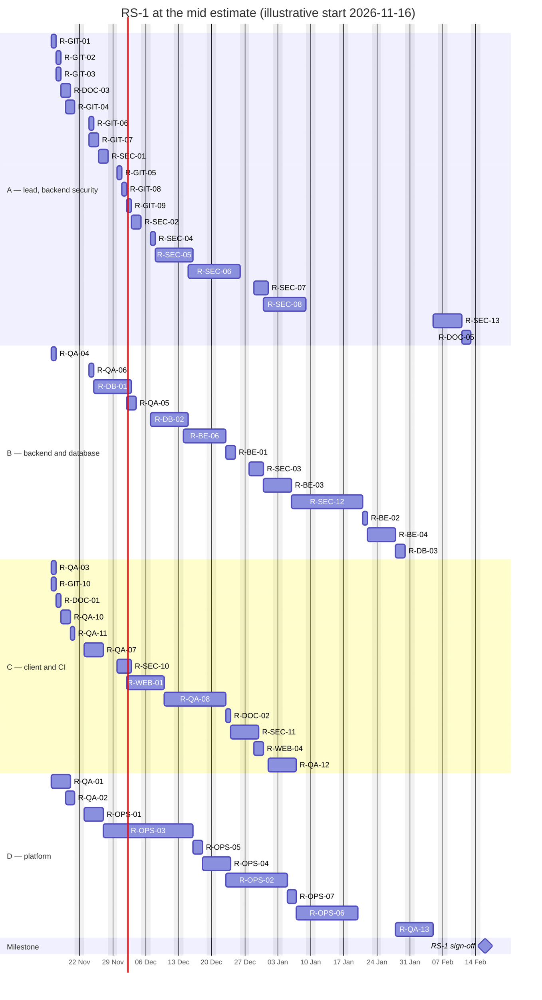

# Medora — Implementation Roadmap

| | |
| --- | --- |
| Date | 2026-11-10 |
| Source | Every task, estimate and dependency comes from `MASTER_REMEDIATION_BACKLOG.md` §3. Phase totals and schedules were computed from that table by script; assumptions are in `ESTIMATES_AND_RESOURCE_PLAN.md` §1. |
| Status | A plan. No phase has started; each needs explicit authorisation. |
| Amended | 2026-11-10, Phase 0 completion — see §4 (R-DB-02 re-scoped, R-DB-05 and R-SEC-14 added, recomputed schedules; hosting still pending; Phase 1 not authorised) |

Effort is in engineer-days (ed). Calendar figures assume the four-person team, a focus
factor of 0.7, and the decision dates in `ESTIMATES_AND_RESOURCE_PLAN.md` §1.3. They
exclude public holidays and vendor lead times.

---

## 1. Phases

### Phase 0 — Repository stabilisation and change protection

| Field | Detail |
| --- | --- |
| Tasks (18) | R-GIT-01 … R-GIT-10, R-QA-01 … R-QA-06, R-DOC-01, R-DOC-02 |
| Effort | **11–20.5 ed** |
| Dependencies | None to start. Owner decisions D-1 (for R-GIT-09) and D-9 (for R-GIT-05); repository-admin access (R-GIT-10) |
| Expected risk reduction | Removes the P0 from `main` (MED-SEC-014 via R-GIT-04), two P2 security defects (MED-SEC-011, MED-ARCH-006), the dev-stack failure, the only unrecoverable risk to user work (MED-REL-001), and the silently passing CI gate. Establishes the evidence base: an environment, a baseline and failing tests |
| Deliverables | Four committed slices of the working tree; one trunk; owner-decision record on `main`; integration environment; Node 22 pinned; honest CI gate; dated baseline of every suite; failing tests for MED-SEC-001, MED-DB-001, MED-SEC-014; truthful README |
| Entry criteria | A recoverable copy of the 106 uncommitted paths exists outside the repository |
| Exit criteria | `backend`, `frontend`, `patient-app` at `0 0` against `main`; full suite green on the trunk on Node 22 with zero unexplained failures; the three failing tests fail for the predicted reason on the pre-fix code; R-GIT-01's four PRs open |
| Do not proceed if | Any suite on the trunk has failures that cannot be explained; the D-9 conflict is unresolved and R-GIT-05 has been merged anyway; the working tree lost any path |

### Phase 1 — Critical security and data-integrity remediation

| Field | Detail |
| --- | --- |
| Tasks (14) | R-SEC-01, R-SEC-02, R-SEC-03, R-SEC-04, R-SEC-05, R-SEC-10, R-DB-01, R-DB-02, R-BE-03, R-BE-01, R-OPS-01, R-OPS-03, R-OPS-04, R-OPS-05 |
| Effort | **28–51 ed** |
| Dependencies | Phase 0 exit; D-7 (hosting) for R-OPS-01 and R-SEC-03; D-6′ for R-DB-02; D-10 for R-BE-03 |
| Expected risk reduction | Closes the credential-exposure path (MED-SEC-001), double booking (MED-DB-001), fail-open configuration (MED-SEC-002), abuse resistance (MED-SEC-003), the unrecoverable data-loss risk (MED-OPS-001), stale revocation (MED-SEC-007), and the write-reach gap (MED-BE-004); decides tenancy sequencing |
| Deliverables | Fixed auth paths with tests; a production-profile contract; per-request session validation with measured latency; `btree_gist` exclusion constraint; the D-6′ decision paper (and expand migration if chosen); write capability on chart mutation; hosting design; PITR and an OD-006 restore drill; encryption and TLS evidence; scanner running and downloads proven |
| Entry criteria | Phase 0 exit; D-7 decided (else Phase 1 runs without the OPS tasks, and the phase cannot exit) |
| Exit criteria | G-03 criteria 3.1, 3.2, 3.5, 3.7, 3.8; G-04 4.1–4.3; G-09 9.1–9.5; G-05 5.1, 5.2; G-01 1.2 — all with evidence |
| Do not proceed if | The restore drill fails or its evidence lives only in the restored database; the session-validation latency is unacceptable and no decision has been taken on it; pre-flight found overlapping appointments that nobody has resolved |

### Phase 2 — Backend and database correctness

| Field | Detail |
| --- | --- |
| Tasks (12) | R-SEC-06, R-SEC-07, R-SEC-08, R-SEC-11, R-SEC-12, R-BE-02, R-BE-04, R-BE-06, R-DB-03, R-OPS-02, R-OPS-07, R-DOC-03 |
| Effort | **29.5–55.5 ed** |
| Dependencies | Phase 1 (R-SEC-05 before R-SEC-06; R-OPS-01 before R-OPS-02/07); D-4, D-5, D-14; owner approval of ADR amendments (A1) |
| Expected risk reduction | Enforces FINAL session and 2FA policy (OD-004, OD-005); finds the next MED-SEC-014 before a user does (R-BE-06); makes releases repeatable and reversible (R-OPS-02); proves key rotation (R-OPS-07); closes the web transport gaps |
| Deliverables | Role-based idle limits and absolute session lifetime in three trees; password-expiry decision implemented; mandatory staff 2FA (TOTP); CSP and https-only web; data export and retention-requirements document; complete readiness; `501` routes resolved; module review report with scope tests; release and rollback runbook; rotation runbook; amended ADR-035 §7 and ADR-007 |
| Entry criteria | Phase 1 exit |
| Exit criteria | G-01 1.3, 1.9; G-02 2.2; G-03 3.3, 3.4, 3.6; G-05 5.5, 5.6, 5.9; G-11 11.7; G-12 12.3 |
| Do not proceed if | R-BE-06 finds an open P0 or P1; a release rehearsal cannot roll back; key rotation was not rehearsed |

### Phase 3 — Patient application and web functionality

| Field | Detail |
| --- | --- |
| Tasks (18) | R-BE-05, R-BE-07, R-BE-08, R-BE-09, R-BE-10, R-BE-11, R-BE-12, R-SEC-09, R-MOB-01 … R-MOB-06, R-WEB-01 … R-WEB-04 |
| Effort | **74–130 ed** (of which 10–16 ed is patient messaging, only if D-3 keeps it) |
| Dependencies | R-DB-01, R-DB-02; D-2 (ADR-033), D-3, D-6′, D-8, D-11, D-12 (ADR-031) |
| Note | **R-WEB-01 and R-WEB-04 belong to RS-1** and are scheduled early, inside the RS-1 window. The rest is RS-2 |
| Expected risk reduction | Turns the patient app into a product without weakening isolation; makes the audit ledger and admin oversight usable in a live build |
| Deliverables | Published-slot booking with DB-enforced single booking; cancellation and rescheduling; patient records with release control; clinic and approved emergency content; push; SMS and passkeys; live admin sections and staff messaging; store-ready builds |
| Entry criteria | RS-1 signed off (recommended), or at minimum Phase 2 exit and the relevant decisions recorded |
| Exit criteria | G-01 1.4; G-04 4.7, 4.8; G-05 5.8; G-06 6.4, 6.5; G-08 8.3; traceability rows for RS-2 all "Implemented" |
| Do not proceed if | Any patient route lacks a cross-patient isolation test; emergency content lacks clinical sign-off; ADR-031 or ADR-033 not accepted for the routes they govern |

### Phase 4 — AI integration and safety

| Field | Detail |
| --- | --- |
| Tasks (7) | R-AI-01 … R-AI-06, R-DB-04 |
| Effort | **23.5–45.5 ed** for the clinician assistant; patient-facing AI not estimated |
| Dependencies | D-3, D-8, D-11; R-DB-02 (DR-12); R-SEC-03 |
| Expected risk reduction | Ensures that the first model output a clinician sees is governed, evaluated, minimised and bounded |
| Deliverables | Intended-use statement; processor agreement; minimised prompt; safety layer; evaluation dataset and runner; clinician-signed report; hospital-scoped context; adapter behind an owner-controlled flag; patient-AI charter |
| Entry criteria | RS-1 signed off; AI confirmed in scope (D-3); a named clinician with time allocated |
| Exit criteria | G-07 7.4–7.10 with clinical and legal approval |
| Do not proceed if | No clinical owner; no processor agreement; the evaluation runner does not gate prompt changes |

### Phase 5 — Quality engineering and reliability

| Field | Detail |
| --- | --- |
| Tasks (7) | R-QA-07, R-QA-08, R-QA-09, R-QA-10, R-QA-11, R-QA-12, R-OPS-06 |
| Effort | **18.5–31.5 ed** |
| Dependencies | R-QA-01, R-QA-02; R-OPS-01; D-8 for the error-tracking vendor |
| Note | Everything here except R-QA-09 (mobile E2E) is **RS-1 work** and runs in parallel with Phases 1–2 in the four-person plan |
| Expected risk reduction | Makes regressions visible before users see them; makes incidents visible in minutes |
| Deliverables | Stable suites; browser smoke suite in CI; device smoke suite; secret scanning and SAST; pinned Actions; performance baseline; error tracking, alerts, runbooks, on-call |
| Entry criteria | Phase 0 exit |
| Exit criteria | G-11 11.4, 11.5 (11.6 for RS-2); G-10 10.2, 10.3; G-12 12.1, 12.2, 12.4, 12.5 |
| Do not proceed if | Any suite is flaky under load; an alert was never observed firing |

### Phase 6 — Release readiness and independent verification

| Field | Detail |
| --- | --- |
| Tasks | Mandatory: R-QA-13, R-SEC-13, R-DOC-04, R-DOC-05. Optional: R-WEB-05, R-DOC-06, R-BE-13 |
| Effort | **8–14 ed** mandatory; 11–22 ed optional |
| Dependencies | Every other task in the scenario (R-QA-13 lists 30 prerequisites); a booked penetration-test window |
| Expected risk reduction | Independent confirmation that the released commit, as deployed, meets every gate |
| Deliverables | Release-candidate evidence pack; penetration-test report; signed sign-off record per scenario |
| Entry criteria | Every RS task for the scenario merged and deployed to staging |
| Exit criteria | Every gate for the scenario signed in the sign-off record with technical, clinical and legal approvals as required |
| Do not proceed if | Any critical or high penetration-test finding is open; any gate lacks a required approver |

---

## 2. Sequential roadmap (one phase at a time)

All four engineers work on one phase; the next starts only when it exits. Mid estimates,
computed with the same scheduler as §3.

| Phase | Duration (mid) | Ends at week |
| --- | ---: | ---: |
| 0 | 2.6 weeks | 2.6 |
| 1 | 5.4 weeks | 8.1 |
| 2 | 7.0 weeks | 15.1 |
| 3 | 12.4 weeks | 27.5 |
| 4 | 12.6 weeks | 40.1 |
| 5 | 5.7 weeks | 45.9 |
| 6 | 2.4 weeks | 48.3 |

About **48 weeks** at the mid estimate for everything mandatory. It is shown only as a
baseline: it is slow because phases with one long chain (Phase 4's safety work sits on
one person) leave three engineers idle, and because Phase 5's RS-1 work waits behind
Phases 3 and 4. **Not recommended.**

---

## 3. Parallel roadmap for a four-person team (recommended)

Ordered by scenario, not by phase. Work starts in all four lanes on day one, each lane
taking the highest-priority task whose dependencies and decisions are met.

### 3.1 Milestones

| Milestone | Low | Mid | High |
| --- | ---: | ---: | ---: |
| **RS-1 signed off** (clinician pilot with real data), RS-1 work only | 9.1 weeks | **13.2 weeks** | 17.3 weeks |
| **RS-2 signed off** (public patient release), after RS-1, including patient messaging | 15.4 | **22.0** | 27.9 |
| RS-2 without patient messaging | 14.9 | 21.2 | 27.9 |
| **RS-3** (AI clinician release) added to the above | 17.8 | **25.1** | 32.4 |

Add to every figure: the penetration-test vendor's lead time if not booked in week one;
public holidays (the mid RS-1 window crosses the year-end break); and any decision that
arrives later than §1.3 of the estimates document assumes.

**Keep RS-1 and RS-2 build work separate.** When RS-2 tasks are allowed to compete for the
same lanes, RS-1 sign-off moves from 13.2 to about **20.3 weeks** at the mid estimate.
During RS-1, spare capacity goes to RS-2 *design and decision papers*, not RS-2 code.

### 3.2 RS-1 lane plan (mid estimate)

| Lane | Weeks 1–3 | Weeks 4–7 | Weeks 8–11 | Weeks 12–14 |
| --- | --- | --- | --- | --- |
| **A** Lead, backend security | R-GIT-01 … R-GIT-09, R-DOC-03, R-SEC-01, R-SEC-02 | R-SEC-04, R-SEC-05, R-SEC-06, R-SEC-07 | R-SEC-08; then ADR-033 and ADR-031 decision papers | R-SEC-13 support, R-DOC-05 |
| **B** Backend, database | R-QA-04, R-QA-06, R-DB-01, R-QA-05, R-DB-02 | R-DB-02, R-BE-06, R-BE-01, R-SEC-03, R-BE-03 | R-BE-03, R-SEC-12, R-BE-02, R-BE-04 | R-DB-03 |
| **C** Client, CI hygiene | R-QA-03, R-GIT-10, R-DOC-01, R-QA-10, R-QA-11, R-QA-07, R-SEC-10, R-WEB-01 | R-WEB-01, R-QA-08, R-DOC-02, R-SEC-11, R-WEB-04 | R-QA-12; test support for B | RS-2 client design |
| **D** Platform | R-QA-01, R-QA-02, R-OPS-01, R-OPS-03 | R-OPS-03, R-OPS-05, R-OPS-04, R-OPS-02 | R-OPS-02, R-OPS-07, R-OPS-06 | R-QA-13 |

Lane B is the busiest during RS-1, and its last RS-1 task (R-BE-04) is what releases
release-candidate verification. Lane C has about five weeks of slack in this window.

### 3.3 RS-1 schedule (generated)

Bars come from the scheduler at the mid estimate. The start date is illustrative.

### 3.4 After RS-1

| Lane | RS-2 focus | RS-3 focus (if in scope) |
| --- | --- | --- |
| A | R-BE-09, R-BE-10, R-BE-12, R-SEC-09 | R-AI-01, R-AI-02, R-AI-03, R-AI-05 |
| B | R-BE-08, R-BE-11, R-BE-07, R-BE-05 | R-AI-04, R-DB-04 |
| C | R-MOB-01 … R-MOB-05, R-WEB-02, R-WEB-03, R-QA-09 | Web half of R-AI-05 |
| D | R-MOB-06, store pipeline, RS-2 release candidate | — |

Lane A becomes the bottleneck. The model shows a fifth engineer shortens RS-2 by only
about one week at the mid estimate, whether that person is mobile or backend, because
RS-2's long chain (R-DB-01 → R-BE-08 → R-BE-09 → R-MOB-01) and its decisions, not lane
capacity, set the pace. Spend on decisions before people.

### 3.5 Decision calendar the parallel plan assumes

| By end of | Decisions |
| --- | --- |
| Week 1 | D-7 hosting |
| Week 2 | D-6′ tenancy sequencing; D-9 OTP value; D-10 reception; D-1 branch model; D-4 password expiry; D-14 2FA clarifications |
| Week 4 | D-2 (ADR-033); D-12 (ADR-031); D-11 clinical owner; D-3 release scope; D-8 processors; D-5 retention requirements |

Each week a decision slips past this calendar delays every task downstream of it.
`REMEDIATION_DEPENDENCY_GRAPH.md` §5 lists their reach (D-7: 18 tasks).

## 4. Phase 0 completion amendment (2026-11-10)

Sections 1–3 are kept as written. These changes supersede them where they differ. All
figures come from the same script over the amended backlog index (85 tasks).

**Phase 1 gains two tasks and a heavier R-DB-02.** Phase 1 is now 15 tasks, **34–64 ed**
(was 14 tasks, 28–51 ed):

- **R-DB-02** is delivery, not a decision paper: the hospital/tenant key implemented and
  verified before real data (owner, D-6′ resolved; mandatory gate G-02 2.6), 6–12 ed. The
  §1 deliverable "the D-6′ decision paper (and expand migration if chosen)" now reads "the
  expand migration and its verification".
- **R-DB-05** (new, MED-DB-004, P1): separate runtime and migration roles; `INSERT`/`SELECT`
  only on the audit ledger for the runtime role; an append-only design enforced in the
  database; negative tests run as the runtime role. 3–6 ed, lane B, after R-GIT-04 and
  R-QA-01. Local; it does not wait for hosting.
- Phase 1's dependencies on D-6′ and D-10 are gone (both resolved); D-7 still gates
  R-OPS-01 and R-SEC-03 and through them the rest of the infrastructure work.

**Phase 2 gains R-SEC-14** (new, MED-SEC-015, P3): hospital-scoped API keys, 2–4 ed, lane
A, after R-DB-02. The interim step waits on D-15 (O-14: disable issuance now or not).
Phase 2 is now 13 tasks, 31.5–59.5 ed.

**R-OPS-02 waits for R-DB-05** — the migration-release procedure runs under the migration
role.

**Schedules (four engineers).**

| Milestone | Low | Mid | High |
| --- | ---: | ---: | ---: |
| RS-1 signed off, RS-1 work only (was 9.1 / 13.2 / 17.3) | 10.9 weeks | **15.9 weeks** | 21.0 weeks |
| RS-1 + RS-2, including conditional messaging (was 15.4 / 22.0 / 27.9) | 16.3 weeks | **23.9 weeks** | 31.6 weeks |
| RS-1 + RS-2 + RS-3 (was 17.8 / 25.1 / 32.4) | 18.4 weeks | **26.4 weeks** | 34.7 weeks |

Lane B (backend, database) now ends RS-1 at 69.6 working days mid (was 56.1): R-DB-02,
R-DB-05, R-DB-01 and the migration-heavy work all sit there. A second backend/database
engineer, or moving R-SEC-14 and R-SEC-12 elsewhere, is the lever if this matters more than
the cost. The one-phase-at-a-time sequential plan moves from 48.1 to 48.8 weeks mid (same
script, before and after).

**Decision calendar (§3.5).** D-6′, D-9 and D-10 were decided on 2026-11-10, ahead of the
calendar. **D-7 hosting is still pending** — the week-1 assumption has already slipped;
every week beyond it delays the 18 tasks in `MASTER_REMEDIATION_BACKLOG.md` §6.5. D-15
(O-14) joins week 2.

**Phase 0 status.** Partly complete: see
`audit-reports/2026-11-10-rs1-implementation/PHASE_0_COMPLETION_REPORT.md`. Phase 1 is not
authorised.

## 5. Status amendment (2026-11-12)

Sections 1–4 are kept as written. Facts measured on 2026-11-12; details in
`audit-reports/2026-11-12-phase0-status/PHASE_0_STATUS_UPDATE.md`.

- **R-GIT-04 done:** `backend` was promoted to `main` (PR #220, `726f1cbf`). The backend MED-SEC-014
  fix and the absolute 10-minute OTP are on `main`. This is branch integration, not deployment.
- **Frontend work merged to `frontend`, not to `main`:** #212, #219 (MED-SEC-014 frontend half),
  #221 and #222 (System Logs). R-GIT-06 is not done.
- **Phase 0 status:** still partly complete. The §1 exit criteria are not met: `frontend` (6 ahead)
  and `patient-app` (22 ahead) are not at `0 0` against `main`, and the full suite is not yet green
  on the trunk on Node 22.
- **Phase 1:** not started.
