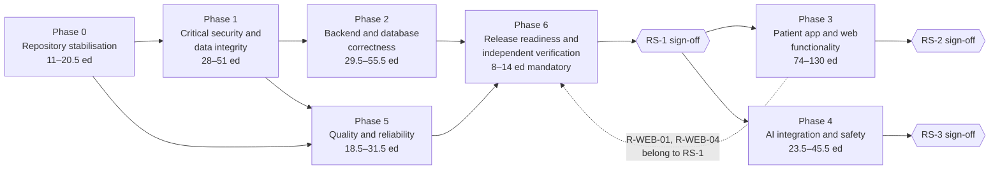
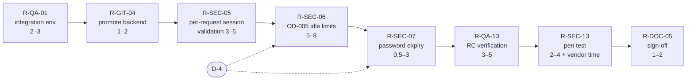
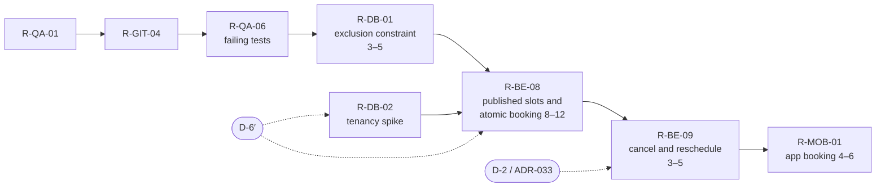
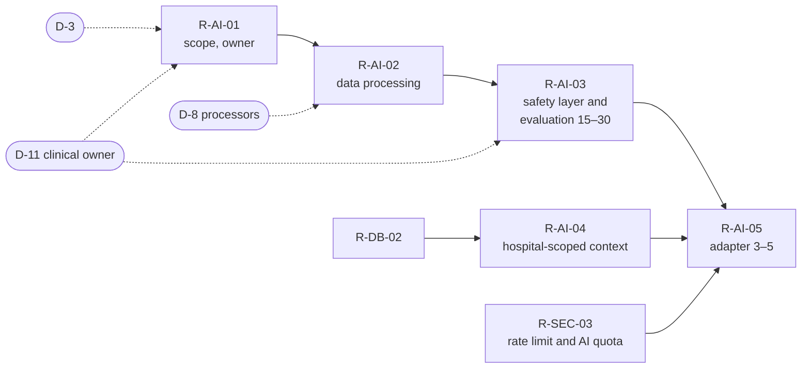

# Medora — Remediation Dependency Graph

| | |
| --- | --- |
| Date | 2026-11-10 |
| Source | Generated from the task index in `MASTER_REMEDIATION_BACKLOG.md` §3 by a script that also checks it: 83 tasks, every dependency resolves, **no cycles**, no task depends on a later phase, and all 57 findings are covered. The adjacency table and the full graph in §8–§9 are that script's output, not hand-drawn. |
| Scenarios | RS-1 clinician pilot with real data · RS-2 public patient release · RS-3 AI-enabled clinician release · RS-4 patient-facing AI (see `POST_AUDIT_STRATEGY.md` §2) |
| Amended | 2026-11-10, Phase 0 completion. §8 and §9 regenerated by the same script from the amended index: **85 tasks, 59 findings, no cycles, no phase inversions**. New nodes R-DB-05 (MED-DB-004) and R-SEC-14 (MED-SEC-015); new edges R-GIT-04, R-QA-01 → R-DB-05 → R-OPS-02, R-QA-13; R-GIT-04, R-DB-02 → R-SEC-14 → R-QA-13. Hand-written §1–§7 are kept as written; what changed in them is listed in §10 |

Two kinds of edge appear. **Task edges** (`A → B`: B cannot start until A is merged)
come from the index. **Decision edges** (`D-n ⇢ task`) mark tasks that cannot start
until an owner decides; they are listed separately because their duration is not an
engineering estimate.

---

## 1. Phase-level view

Phases group work by kind; scenarios decide what ships. RS-1 needs Phases 0, 1, 2, the
RS-1 tasks of Phases 3 and 5 (R-WEB-01, R-WEB-04, R-QA-07, R-QA-08, R-QA-10 … R-QA-12,
R-OPS-06) and the RS-1 tasks of Phase 6.

---

## 2. Critical paths

"Critical path" here means the longest chain of task dependencies if staffing were
unlimited. The four-person, resource-constrained view is in §6 and in
`IMPLEMENTATION_ROADMAP.md`.

### 2.1 RS-1 — clinician pilot with real data (17.5–32 engineer-days of chain)

The chain is the session-security work, because OD-005 and O-13 are FINAL and must be
enforced server-side before real data. The external penetration test adds vendor
calendar time that no estimate here includes; book it in week one.

### 2.2 RS-2 — public patient release (21.5–34 engineer-days of chain)

### 2.3 RS-3 — AI-enabled clinician release (19.5–38 engineer-days of chain)

---

## 3. Must be sequential

These chains cannot be compressed by adding people.

| Chain | Why the order is fixed |
| --- | --- |
| R-GIT-01 → R-GIT-02 → R-GIT-04 → R-GIT-06 → R-GIT-07 → R-GIT-08 → R-GIT-09 | Protect work, re-measure, then land trees in the order that minimises conflicts (`BRANCH_RECONCILIATION_PLAN.md` §8) |
| R-QA-01 → R-QA-06 → { R-SEC-01, R-DB-01 } | A failing test needs an environment, and the fix needs the failing test |
| R-SEC-05 → R-SEC-06 → R-SEC-07 | Idle limits are enforced on top of per-request session validation |
| R-SEC-08 → R-SEC-09 | SMS and passkeys extend the mandatory-2FA mechanism |
| R-BE-03 → R-BE-05, and R-BE-03 before any DR-05 or D6-3 change | Widening reach before the write capability exists widens write access (RK-03) |
| R-DB-01 → R-BE-08 → R-BE-09 → R-MOB-01 | Constraint, then the slot model, then patient actions, then the client |
| R-OPS-01 → R-OPS-03 → R-QA-13 | Hosting decides where backups live; the release candidate needs a rehearsed restore |
| R-AI-01 → R-AI-02 → R-AI-03 → R-AI-05 | No adapter before a data-processing decision and a safety layer |
| R-QA-13 → R-SEC-13 → R-DOC-05 | Test the candidate, test it independently, then sign |

## 4. Can run in parallel

| Wave | Tasks that can run side by side | Shared files to watch |
| --- | --- | --- |
| Day 1 (no dependency) | R-GIT-01, R-QA-01, R-QA-02, R-QA-03, R-QA-04, R-DOC-01, R-QA-11; decision papers for D-6′ (R-DB-02 drafting) and D-7 (R-OPS-01) | `.github/workflows/ci.yml` (R-QA-02, R-QA-03, R-QA-11) — sequence their PRs |
| After R-GIT-04 | R-SEC-01, R-SEC-02, R-SEC-05, R-DB-01, R-DB-02, R-BE-03, R-BE-06, R-SEC-08 (with D-14), R-GIT-05 (with D-9) | `backend/src/config/env.schema.ts` (R-SEC-02, R-SEC-03); `auth/` (R-SEC-01, R-SEC-05, R-SEC-08) — one owner for `auth/` |
| After R-OPS-01 | R-OPS-02, R-OPS-03, R-OPS-04, R-OPS-05, R-OPS-06, R-OPS-07, R-SEC-11 | Infrastructure definitions only |
| After R-GIT-06 / R-GIT-07 | R-WEB-01, R-QA-08, R-SEC-10, R-QA-05 | `frontend/src/types/auth` is the source of truth for backend parity specs: any catalogue change (R-BE-03) runs both suites |
| RS-2 build | Backend patient routes (R-BE-08 … R-BE-12) and admin web sections (R-WEB-02, R-WEB-03) | The permission catalogue again |

## 5. Blocked by product, clinical, legal or security decisions

Generated from the index. "Transitive" counts every task that cannot finish until the
decision is made, including tasks downstream of the directly blocked ones.

| Decision | Directly blocks | Transitive reach | Owner |
| --- | --- | --- | --- |
| D-7 Hosting | R-OPS-01, R-SEC-03 | **18 tasks, 44.5–86 ed** | Engineering lead |
| D-3 First-release scope | R-AI-01, R-BE-04, R-BE-05, R-BE-12, R-MOB-04, R-WEB-03 | 13 tasks, 46.5–94 ed | Product owner |
| D-8 Processors | R-AI-02, R-AI-05, R-BE-07, R-MOB-06, R-OPS-06, R-SEC-09 | 11 tasks, 43–80 ed | Legal, engineering |
| D-6′ Tenancy sequencing | R-DB-02, R-BE-08, R-WEB-02, R-AI-04 | 10 tasks, 37–63 ed | Product, architecture |
| D-11 Clinical owner | R-AI-01, R-AI-03, R-BE-11 | 7 tasks, 25.5–48 ed | Organisation |
| D-10 Reception scope | R-BE-03, R-BE-05 | 5 tasks, 13–30 ed | Project owner |
| D-14 2FA clarifications | R-SEC-08 | 5 tasks, 14–25 ed | Project owner |
| D-5 Retention and export | R-SEC-12 | 5 tasks, 12–26 ed | Legal |
| D-4 Session policy remainder | R-SEC-06, R-SEC-07 | 5 tasks, 11.5–22 ed | Security owner |
| D-1 Branch model | R-GIT-09 | 5 tasks, 11.5–22 ed | Engineering lead |
| D-9 OTP lifetime | R-GIT-05, R-SEC-04 | 5 tasks, 7–13 ed | Project owner |
| D-12 Results release (ADR-031) | R-BE-10 | 2 tasks, 9–15 ed | Clinical, product |
| D-2 Cancel and reschedule (ADR-033) | R-BE-09 | 2 tasks, 7–11 ed | Product, clinical |
| D-13 `Database` branch | (part of R-GIT-08; non-blocking) | 0 | Engineering lead |

D-7 has the widest reach of any single item in the plan. It is also the cheapest to make.

## 6. Blocked by infrastructure or external services

| Blocked task | Waits for | External party |
| --- | --- | --- |
| R-OPS-03, R-OPS-04, R-OPS-05, R-OPS-02 | Provisioned hosting (R-OPS-01) | Cloud or hosting provider |
| R-SEC-03 | The real proxy topology for `TRUST_PROXY` | Hosting |
| R-BE-01 | A running clamd (R-OPS-05) | ClamAV signatures |
| R-BE-07, R-MOB-05, R-SEC-09 | Push and SMS providers | Processors under D-8 |
| R-OPS-06 | An error-tracking vendor | Processor under D-8 |
| R-AI-05 | A model provider under contract | Processor under D-8 |
| R-MOB-06, R-QA-09 | EAS project, signing credentials, store accounts | Apple, Google, Expo |
| R-SEC-13 | Penetration-test vendor | External |
| R-GIT-10 | Repository administrator access | GitHub org admin |

## 7. Cycles

The task graph has **no cycles** (checked). Four cycles exist at the decision level; each
is broken as shown.

| Cycle | Break |
| --- | --- |
| Tenancy ↔ integration: web sections and the AI seam wait for the tenant model, which assumes integrated features to migrate | Decide D-6′. Recommended: tenant key first (R-DB-02 option b), then integrate against it |
| Booking model ↔ booking integrity | Ship the range-exclusion constraint (R-DB-01) now; it holds under the published-slot model too |
| Parity tests ↔ branch divergence: parity specs pass against stale counterparts while trees diverge | Reconcile once (R-GIT-04 … R-GIT-07), then the drift check (R-GIT-09) |
| Owner record ↔ code: `21c4b3bd` cites a decision the record contradicts | The owner settles D-9 before R-GIT-05 merges |

---

## 8. Full task graph (generated)

Edges into R-QA-13 (32 of them since the Phase 0 completion amendment; 30 before) are summarised as one node to keep the graph legible;
they are listed in §9. Optional tasks (R-WEB-05, R-DOC-06, R-BE-13) are omitted.

```mermaid
flowchart LR
  subgraph GIT["Repository"]
    R_GIT_01["R-GIT-01"]
    R_GIT_02["R-GIT-02"]
    R_GIT_03["R-GIT-03"]
    R_GIT_04["R-GIT-04"]
    R_GIT_05["R-GIT-05"]
    R_GIT_06["R-GIT-06"]
    R_GIT_07["R-GIT-07"]
    R_GIT_08["R-GIT-08"]
    R_GIT_09["R-GIT-09"]
    R_GIT_10["R-GIT-10"]
  end
  subgraph SEC["Security"]
    R_SEC_01["R-SEC-01"]
    R_SEC_02["R-SEC-02"]
    R_SEC_03["R-SEC-03"]
    R_SEC_04["R-SEC-04"]
    R_SEC_05["R-SEC-05"]
    R_SEC_10["R-SEC-10"]
    R_SEC_06["R-SEC-06"]
    R_SEC_07["R-SEC-07"]
    R_SEC_08["R-SEC-08"]
    R_SEC_11["R-SEC-11"]
    R_SEC_12["R-SEC-12"]
    R_SEC_14["R-SEC-14"]
    R_SEC_09["R-SEC-09"]
    R_SEC_13["R-SEC-13"]
  end
  subgraph BE["Backend"]
    R_BE_03["R-BE-03"]
    R_BE_01["R-BE-01"]
    R_BE_02["R-BE-02"]
    R_BE_04["R-BE-04"]
    R_BE_06["R-BE-06"]
    R_BE_05["R-BE-05"]
    R_BE_07["R-BE-07"]
    R_BE_08["R-BE-08"]
    R_BE_09["R-BE-09"]
    R_BE_10["R-BE-10"]
    R_BE_11["R-BE-11"]
    R_BE_12["R-BE-12"]
  end
  subgraph DB["Database"]
    R_DB_01["R-DB-01"]
    R_DB_02["R-DB-02"]
    R_DB_05["R-DB-05"]
    R_DB_03["R-DB-03"]
    R_DB_04["R-DB-04"]
  end
  subgraph MOB["Mobile"]
    R_MOB_01["R-MOB-01"]
    R_MOB_02["R-MOB-02"]
    R_MOB_03["R-MOB-03"]
    R_MOB_04["R-MOB-04"]
    R_MOB_05["R-MOB-05"]
    R_MOB_06["R-MOB-06"]
  end
  subgraph WEB["Web"]
    R_WEB_01["R-WEB-01"]
    R_WEB_02["R-WEB-02"]
    R_WEB_03["R-WEB-03"]
    R_WEB_04["R-WEB-04"]
  end
  subgraph AI["AI"]
    R_AI_01["R-AI-01"]
    R_AI_02["R-AI-02"]
    R_AI_03["R-AI-03"]
    R_AI_04["R-AI-04"]
    R_AI_05["R-AI-05"]
    R_AI_06["R-AI-06"]
  end
  subgraph QA["QA"]
    R_QA_01["R-QA-01"]
    R_QA_02["R-QA-02"]
    R_QA_03["R-QA-03"]
    R_QA_04["R-QA-04"]
    R_QA_05["R-QA-05"]
    R_QA_06["R-QA-06"]
    R_QA_07["R-QA-07"]
    R_QA_08["R-QA-08"]
    R_QA_09["R-QA-09"]
    R_QA_10["R-QA-10"]
    R_QA_11["R-QA-11"]
    R_QA_12["R-QA-12"]
    R_QA_13["R-QA-13"]
  end
  subgraph OPS["Infrastructure"]
    R_OPS_01["R-OPS-01"]
    R_OPS_03["R-OPS-03"]
    R_OPS_04["R-OPS-04"]
    R_OPS_05["R-OPS-05"]
    R_OPS_02["R-OPS-02"]
    R_OPS_07["R-OPS-07"]
    R_OPS_06["R-OPS-06"]
  end
  subgraph DOC["Docs"]
    R_DOC_01["R-DOC-01"]
    R_DOC_02["R-DOC-02"]
    R_DOC_03["R-DOC-03"]
    R_DOC_04["R-DOC-04"]
    R_DOC_05["R-DOC-05"]
  end
  R_GIT_01 --> R_GIT_02
  R_GIT_02 --> R_GIT_03
  R_GIT_02 --> R_GIT_04
  R_QA_01 --> R_GIT_04
  R_GIT_04 --> R_GIT_05
  R_GIT_01 --> R_GIT_06
  R_GIT_04 --> R_GIT_06
  R_GIT_06 --> R_GIT_07
  R_QA_02 --> R_GIT_07
  R_GIT_07 --> R_GIT_08
  R_GIT_08 --> R_GIT_09
  R_QA_03 --> R_GIT_10
  R_GIT_07 --> R_QA_05
  R_QA_01 --> R_QA_05
  R_QA_02 --> R_QA_05
  R_GIT_04 --> R_QA_06
  R_QA_01 --> R_QA_06
  R_GIT_08 --> R_DOC_02
  R_GIT_04 --> R_SEC_01
  R_QA_06 --> R_SEC_01
  R_GIT_04 --> R_SEC_02
  R_SEC_02 --> R_SEC_03
  R_OPS_01 --> R_SEC_03
  R_GIT_05 --> R_SEC_04
  R_GIT_04 --> R_SEC_05
  R_GIT_07 --> R_SEC_10
  R_QA_03 --> R_SEC_10
  R_GIT_04 --> R_DB_01
  R_QA_06 --> R_DB_01
  R_GIT_04 --> R_DB_02
  R_GIT_04 --> R_DB_05
  R_QA_01 --> R_DB_05
  R_GIT_04 --> R_BE_03
  R_GIT_04 --> R_BE_01
  R_OPS_05 --> R_BE_01
  R_OPS_01 --> R_OPS_03
  R_OPS_01 --> R_OPS_04
  R_OPS_01 --> R_OPS_05
  R_SEC_05 --> R_SEC_06
  R_SEC_06 --> R_SEC_07
  R_GIT_04 --> R_SEC_08
  R_OPS_01 --> R_SEC_11
  R_GIT_04 --> R_SEC_12
  R_OPS_01 --> R_SEC_12
  R_GIT_04 --> R_SEC_14
  R_DB_02 --> R_SEC_14
  R_GIT_04 --> R_BE_02
  R_OPS_03 --> R_BE_04
  R_SEC_12 --> R_BE_04
  R_GIT_04 --> R_BE_06
  R_GIT_04 --> R_DB_03
  R_QA_01 --> R_DB_03
  R_OPS_01 --> R_OPS_02
  R_DB_05 --> R_OPS_02
  R_OPS_01 --> R_OPS_07
  R_GIT_04 --> R_OPS_07
  R_GIT_03 --> R_DOC_03
  R_BE_03 --> R_BE_05
  R_GIT_04 --> R_BE_07
  R_DB_01 --> R_BE_08
  R_DB_02 --> R_BE_08
  R_BE_08 --> R_BE_09
  R_GIT_04 --> R_BE_10
  R_GIT_04 --> R_BE_11
  R_GIT_04 --> R_BE_12
  R_SEC_08 --> R_SEC_09
  R_BE_07 --> R_SEC_09
  R_BE_08 --> R_MOB_01
  R_BE_09 --> R_MOB_01
  R_BE_10 --> R_MOB_02
  R_BE_11 --> R_MOB_03
  R_BE_12 --> R_MOB_04
  R_BE_07 --> R_MOB_05
  R_GIT_07 --> R_MOB_06
  R_GIT_06 --> R_WEB_01
  R_WEB_01 --> R_WEB_02
  R_BE_01 --> R_WEB_03
  R_OPS_01 --> R_WEB_04
  R_SEC_11 --> R_WEB_04
  R_AI_01 --> R_AI_02
  R_AI_02 --> R_AI_03
  R_DB_02 --> R_AI_04
  R_AI_03 --> R_AI_05
  R_AI_04 --> R_AI_05
  R_SEC_03 --> R_AI_05
  R_AI_01 --> R_AI_06
  R_GIT_04 --> R_DB_04
  R_QA_02 --> R_QA_07
  R_QA_01 --> R_QA_08
  R_GIT_06 --> R_QA_08
  R_QA_01 --> R_QA_09
  R_GIT_07 --> R_QA_09
  R_QA_03 --> R_QA_10
  R_GIT_04 --> R_QA_12
  R_QA_01 --> R_QA_12
  R_OPS_01 --> R_OPS_06
  R_QA_13 --> R_SEC_13
  R_DOC_02 --> R_DOC_04
  R_QA_13 --> R_DOC_05
  R_SEC_13 --> R_DOC_05
  R_DOC_03 --> R_DOC_05
  RS1BUILD(["all other RS-1 build tasks"]) --> R_QA_13
```

## 9. Adjacency table (generated)

| Task | Ph | Depends on | Unblocks | Decisions | Scope |
| --- | ---: | --- | --- | --- | --- |
| R-GIT-01 | 0 | — | R-GIT-02, R-GIT-06 | — | RS-1 |
| R-GIT-02 | 0 | R-GIT-01 | R-GIT-03, R-GIT-04 | — | RS-1 |
| R-GIT-03 | 0 | R-GIT-02 | R-DOC-03 | — | RS-1 |
| R-GIT-04 | 0 | R-GIT-02, R-QA-01 | R-GIT-05, R-GIT-06, R-QA-06, R-SEC-01, R-SEC-02, R-SEC-05, R-DB-01, R-DB-02, R-DB-05, R-BE-03, R-BE-01, R-SEC-08, R-SEC-12, R-SEC-14, R-BE-02, R-BE-06, R-DB-03, R-OPS-07, R-BE-07, R-BE-10, R-BE-11, R-BE-12, R-DB-04, R-QA-12 | — | RS-1 |
| R-GIT-05 | 0 | R-GIT-04 | R-SEC-04 | D-9 | RS-1 |
| R-GIT-06 | 0 | R-GIT-01, R-GIT-04 | R-GIT-07, R-WEB-01, R-QA-08 | — | RS-1 |
| R-GIT-07 | 0 | R-GIT-06, R-QA-02 | R-GIT-08, R-QA-05, R-SEC-10, R-MOB-06, R-QA-09 | — | RS-1 |
| R-GIT-08 | 0 | R-GIT-07 | R-GIT-09, R-DOC-02 | — | RS-1 |
| R-GIT-09 | 0 | R-GIT-08 | R-QA-13, R-DOC-06 | D-1 | RS-1 |
| R-GIT-10 | 0 | R-QA-03 | R-QA-13 | — | RS-1 |
| R-QA-01 | 0 | — | R-GIT-04, R-QA-05, R-QA-06, R-DB-05, R-DB-03, R-QA-08, R-QA-09, R-QA-12 | — | RS-1 |
| R-QA-02 | 0 | — | R-GIT-07, R-QA-05, R-QA-07 | — | RS-1 |
| R-QA-03 | 0 | — | R-GIT-10, R-SEC-10, R-QA-10 | — | RS-1 |
| R-QA-04 | 0 | — | — | — | RS-1 |
| R-QA-05 | 0 | R-GIT-07, R-QA-01, R-QA-02 | R-QA-13 | — | RS-1 |
| R-QA-06 | 0 | R-GIT-04, R-QA-01 | R-SEC-01, R-DB-01 | — | RS-1 |
| R-DOC-01 | 0 | — | — | — | RS-1 |
| R-DOC-02 | 0 | R-GIT-08 | R-DOC-04 | — | RS-1 |
| R-SEC-01 | 1 | R-GIT-04, R-QA-06 | R-QA-13 | — | RS-1 |
| R-SEC-02 | 1 | R-GIT-04 | R-SEC-03, R-QA-13 | — | RS-1 |
| R-SEC-03 | 1 | R-SEC-02, R-OPS-01 | R-AI-05, R-QA-13 | D-7 | RS-1 |
| R-SEC-04 | 1 | R-GIT-05 | R-QA-13 | D-9 | RS-1 |
| R-SEC-05 | 1 | R-GIT-04 | R-SEC-06 | — | RS-1 |
| R-SEC-10 | 1 | R-GIT-07, R-QA-03 | R-QA-13, R-BE-13 | — | RS-1 |
| R-DB-01 | 1 | R-GIT-04, R-QA-06 | R-BE-08, R-QA-13 | — | RS-1 |
| R-DB-02 | 1 | R-GIT-04 | R-SEC-14, R-BE-08, R-AI-04, R-QA-13 | D-6′ | RS-1 |
| R-DB-05 | 1 | R-GIT-04, R-QA-01 | R-OPS-02, R-QA-13 | — | RS-1 |
| R-BE-03 | 1 | R-GIT-04 | R-BE-05, R-QA-13 | D-10 | RS-1 |
| R-BE-01 | 1 | R-GIT-04, R-OPS-05 | R-WEB-03, R-QA-13 | — | RS-1 |
| R-OPS-01 | 1 | — | R-SEC-03, R-OPS-03, R-OPS-04, R-OPS-05, R-SEC-11, R-SEC-12, R-OPS-02, R-OPS-07, R-WEB-04, R-OPS-06 | D-7 | RS-1 |
| R-OPS-03 | 1 | R-OPS-01 | R-BE-04, R-QA-13 | — | RS-1 |
| R-OPS-04 | 1 | R-OPS-01 | R-QA-13 | — | RS-1 |
| R-OPS-05 | 1 | R-OPS-01 | R-BE-01 | — | RS-1 |
| R-SEC-06 | 2 | R-SEC-05 | R-SEC-07, R-QA-13 | D-4 | RS-1 |
| R-SEC-07 | 2 | R-SEC-06 | R-QA-13 | D-4 | RS-1 |
| R-SEC-08 | 2 | R-GIT-04 | R-SEC-09, R-QA-13 | D-14 | RS-1 |
| R-SEC-11 | 2 | R-OPS-01 | R-WEB-04, R-QA-13 | — | RS-1 |
| R-SEC-12 | 2 | R-GIT-04, R-OPS-01 | R-BE-04, R-QA-13 | D-5 | RS-1 |
| R-SEC-14 | 2 | R-GIT-04, R-DB-02 | R-QA-13 | D-15 | RS-1 |
| R-BE-02 | 2 | R-GIT-04 | R-QA-13 | — | RS-1 |
| R-BE-04 | 2 | R-OPS-03, R-SEC-12 | R-QA-13 | D-3 | RS-1 |
| R-BE-06 | 2 | R-GIT-04 | R-QA-13 | — | RS-1 |
| R-DB-03 | 2 | R-GIT-04, R-QA-01 | — | — | RS-1 |
| R-OPS-02 | 2 | R-OPS-01, R-DB-05 | R-QA-13 | — | RS-1 |
| R-OPS-07 | 2 | R-OPS-01, R-GIT-04 | R-QA-13 | — | RS-1 |
| R-DOC-03 | 2 | R-GIT-03 | R-DOC-05 | — | RS-1 |
| R-BE-05 | 3 | R-BE-03 | — | D-3, D-10 | RS-2 |
| R-BE-07 | 3 | R-GIT-04 | R-SEC-09, R-MOB-05 | D-8 | RS-2 |
| R-BE-08 | 3 | R-DB-01, R-DB-02 | R-BE-09, R-MOB-01 | D-6′ | RS-2 |
| R-BE-09 | 3 | R-BE-08 | R-MOB-01 | D-2 | RS-2 |
| R-BE-10 | 3 | R-GIT-04 | R-MOB-02 | D-12 | RS-2 |
| R-BE-11 | 3 | R-GIT-04 | R-MOB-03 | D-11 | RS-2 |
| R-BE-12 | 3 | R-GIT-04 | R-MOB-04 | D-3 | RS-2 |
| R-SEC-09 | 3 | R-SEC-08, R-BE-07 | — | D-8 | RS-2 |
| R-MOB-01 | 3 | R-BE-08, R-BE-09 | — | — | RS-2 |
| R-MOB-02 | 3 | R-BE-10 | — | — | RS-2 |
| R-MOB-03 | 3 | R-BE-11 | — | — | RS-2 |
| R-MOB-04 | 3 | R-BE-12 | — | D-3 | RS-2 |
| R-MOB-05 | 3 | R-BE-07 | — | — | RS-2 |
| R-MOB-06 | 3 | R-GIT-07 | — | D-8 | RS-2 |
| R-WEB-01 | 3 | R-GIT-06 | R-WEB-02, R-QA-13 | — | RS-1 |
| R-WEB-02 | 3 | R-WEB-01 | — | D-6′ | RS-2 |
| R-WEB-03 | 3 | R-BE-01 | — | D-3 | RS-2 |
| R-WEB-04 | 3 | R-OPS-01, R-SEC-11 | R-QA-13 | — | RS-1 |
| R-AI-01 | 4 | — | R-AI-02, R-AI-06 | D-3, D-11 | RS-3 |
| R-AI-02 | 4 | R-AI-01 | R-AI-03 | D-8 | RS-3 |
| R-AI-03 | 4 | R-AI-02 | R-AI-05 | D-11 | RS-3 |
| R-AI-04 | 4 | R-DB-02 | R-AI-05 | D-6′ | RS-3 |
| R-AI-05 | 4 | R-AI-03, R-AI-04, R-SEC-03 | — | D-8 | RS-3 |
| R-AI-06 | 4 | R-AI-01 | — | — | RS-4 |
| R-DB-04 | 4 | R-GIT-04 | — | — | RS-3 |
| R-QA-07 | 5 | R-QA-02 | R-QA-13 | — | RS-1 |
| R-QA-08 | 5 | R-QA-01, R-GIT-06 | R-QA-13 | — | RS-1 |
| R-QA-09 | 5 | R-QA-01, R-GIT-07 | — | — | RS-2 |
| R-QA-10 | 5 | R-QA-03 | R-QA-13 | — | RS-1 |
| R-QA-11 | 5 | — | — | — | RS-1 |
| R-QA-12 | 5 | R-GIT-04, R-QA-01 | — | — | RS-1 |
| R-OPS-06 | 5 | R-OPS-01 | R-QA-13 | D-8 | RS-1 |
| R-SEC-13 | 6 | R-QA-13 | R-DOC-05 | — | RS-1 |
| R-QA-13 | 6 | R-OPS-02, R-OPS-03, R-OPS-04, R-OPS-06, R-OPS-07, R-QA-05, R-QA-07, R-QA-08, R-QA-10, R-SEC-01, R-SEC-02, R-SEC-03, R-SEC-04, R-SEC-06, R-SEC-07, R-SEC-08, R-SEC-10, R-SEC-11, R-SEC-12, R-SEC-14, R-DB-01, R-DB-02, R-DB-05, R-BE-01, R-BE-02, R-BE-03, R-BE-04, R-BE-06, R-WEB-01, R-WEB-04, R-GIT-09, R-GIT-10 | R-SEC-13, R-DOC-05 | — | RS-1 |
| R-DOC-04 | 6 | R-DOC-02 | — | — | RS-2 |
| R-DOC-05 | 6 | R-QA-13, R-SEC-13, R-DOC-03 | — | — | RS-1 |
| R-WEB-05 | 6 | — | — | — | — |
| R-DOC-06 | 6 | R-GIT-09 | — | — | — |
| R-BE-13 | 6 | R-SEC-10 | — | — | — |

## 10. Phase 0 completion amendment (2026-11-10)

Read §1–§7 through this section; where they disagree, this section and the regenerated
§8–§9 win.

**Decisions (§5).**

| Decision | Was | Now | Effect on the graph |
| --- | --- | --- | --- |
| D-6′ | Open; R-DB-02 a decision spike | **Resolved by the owner**: tenant key implemented and verified before real data; mandatory gate | R-DB-02 becomes delivery (6–12 ed). Its reach — 11 tasks, 42–74 ed, now including R-SEC-14 — is no longer waiting on a decision but on R-DB-02's work. The §7 "tenancy ↔ integration" tension is settled the way §7 recommended |
| D-9 | Open | **Resolved**: 10 minutes, absolute | R-GIT-05 done by the owner; R-SEC-04 on `backend` |
| D-10 | Open | **Resolved**: option (a) | R-BE-03 and R-BE-05 no longer decision-blocked by it (R-BE-05 still waits on D-3) |
| D-14 | Open | Partly resolved | R-SEC-08 can be designed; C-10 and C-1 remain |
| D-15 | — | **New, open** (O-14) | Blocks the interim step of R-SEC-14 only |
| D-7 | Open | **Still open (hosting PENDING)** | Unchanged: 18 tasks, 44.5–86 ed — listed one by one, with what each could do locally, in `MASTER_REMEDIATION_BACKLOG.md` §6.5 |

**Critical paths (§2).** RS-1 is unchanged (17.5–32 ed through R-SEC-05 → R-SEC-06 →
R-SEC-07). RS-1 + RS-2 now runs R-QA-01 → R-GIT-04 → **R-DB-02** → R-BE-08 → R-BE-09 →
R-MOB-01, 24–40 ed (was 21.5–34 ed through R-QA-06 → R-DB-01), because R-DB-02 grew from a
spike to delivery.

**Sequential constraints (§3), added.** R-DB-05 before R-OPS-02: the release procedure
must run migrations under the migration role R-DB-05 creates. R-DB-02 before R-SEC-14: a key
cannot be bound to a hospital that has no model.

**Parallel work (§4), added.** After R-GIT-04 and R-QA-01, R-DB-05 runs beside R-DB-01 and
R-DB-02; all three touch `backend/prisma/migrations/`, so one owner (B) sequences their
migrations.

**Infrastructure (§6).** R-DB-05 needs a local PostgreSQL 16 for its negative tests, which
Phase 0 now provides (the local stack is running); it does not need D-7.
